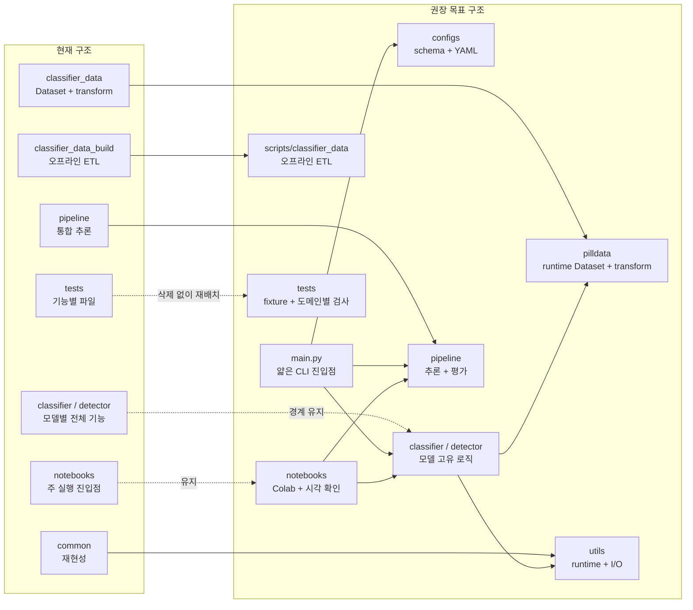

# 프로젝트 구조 리팩터링 계획

| 항목 | 값 |
| --- | --- |
| 상태 | 진행 중 |
| 관련 이슈 | #16 |
| 작업 브랜치 | `16-refactor-project-structure` |
| 최초 작성 | 2026-10-29 |

## 1. 목적

분류기, 탐지기와 통합 파이프라인에 반복 구현된 실행 환경, 파일 저장, 전처리와 입력 검증 코드를 정리한다. 모델별 학습 계약은 유지하면서 공통 기능의 단일 구현을 만들고, Notebook과 자동 실행이 같은 Python 모듈을 사용하도록 구성한다.

탐지기 DataLoader는 별도 작업 중이므로 이번 리팩터링에서는 DataLoader 없이 확정할 수 있는 구조까지만 변경한다. 실제 탐지 Dataset과 공통 데이터 계층의 최종 통합은 탐지기 DataLoader가 완료된 이후 진행한다.

## 2. 리팩터링 전 기준선

2026-10-29 `main` 기준 결과다.

| 검사 | 결과 |
| --- | --- |
| 전체 pytest | `166 passed` |
| `classifier`, `detector`, `common`, `pipeline`, `tests` Ruff | 통과 |
| 위 범위의 Ruff format 검사 | 통과, 32개 파일 |
| `classifier_data`를 포함한 확장 Ruff | 기존 오류 2건 |

`classifier_data/classifier_inputs.py`의 기존 Ruff 오류는 다음과 같다.

- import 순서 1건
- 불필요한 `dict()` 생성 1건

리팩터링 단계에서 전체 검사 범위에 `classifier_data`와 새 공통 패키지를 포함하고 두 오류를 함께 해소한다.

## 진행 현황

| 단계 | 상태 | 결과 |
| --- | --- | --- |
| 0. 계획과 기준선 | 완료 | `ef44c9d` |
| 1. runtime과 공통 I/O | 완료 | `371cf3d` |
| 2. crop과 transform 통합 | 완료 | `1364053` |
| 3. 설정과 `main.py` | 완료 | `256ff2d` |
| 4. 검증 이름과 primitive | 완료 | `d86cea0` |
| 5. 테스트와 문서 정리 | 완료 | 전체 테스트 `204 passed` 및 최종 문서 정리 |
| 6. 문서 기준점 통합 | 검토 대기 | README 단일화, 문서 상태와 후속 구조 단계 정리 |
| 7. runtime 데이터 이전 | 검토 대기 | 분류 Dataset과 factory를 `pilldata/`로 이전하고 기존 패키지 제거 |
| 8. 오프라인 ETL 이전 | 대기 | `classifier_data_build/`를 `scripts/classifier_data/`로 이전 |
| 9. 호환 계층과 Notebook 정리 | 대기 | `common/` 제거와 Notebook 조립 코드 축소 |
| 10. 최종 문서·구조 검증 | 대기 | 실제 구조, 문서, import와 전체 테스트 일치 확인 |

## 3. 현재 문제

| 구분 | 예시 | 정리 방향 |
| --- | --- | --- |
| 실행 환경 중복 | device 선택, seed, RNG, GradScaler | 공통 runtime으로 이동 |
| 파일 저장 중복 | JSON 저장, metrics CSV append | 공통 I/O로 이동 |
| 전처리 분산 | crop, bbox clip, padding, resize | 공통 transform으로 이동 |
| 이름 충돌 | 서로 다른 `validate_detection_batch()` | 역할이 드러나는 이름으로 변경 |
| 검증 primitive 중복 | 문자열, 이미지, bbox, 확률 범위 검사 | 저수준 검사만 공통화 |
| 실행 진입점 분산 | 세 Notebook에서 직접 조립 | 얇은 CLI 진입점 추가 |
| 평가 책임 부족 | end-to-end 평가 API 부재 | pipeline 평가 모듈 추가 |

반복 검증이 모두 불필요한 것은 아니다. DataLoader, checkpoint와 모델 출력처럼 외부 값이 들어오는 경계에서는 검증을 유지하고, 동일한 저수준 구현만 재사용한다.

## 4. 구조 변화



### 목표 폴더 구조

```text
gitkk-pill-detection/
├── main.py
├── configs/
│   ├── __init__.py
│   ├── schema.py
│   ├── classifier.yaml
│   ├── detector.yaml
│   └── pipeline.yaml
├── pilldata/
│   ├── __init__.py
│   ├── classifier_dataset.py
│   ├── factory.py
│   ├── transforms.py
│   ├── validation.py
│   └── synthetic.py
├── classifier/
│   ├── model.py
│   ├── train.py
│   ├── evaluate.py
│   ├── inference.py
│   ├── input_validation.py
│   └── checkpoint.py
├── detector/
│   ├── model.py
│   ├── train.py
│   ├── evaluate.py
│   ├── inference.py
│   ├── input_validation.py
│   └── checkpoint.py
├── pipeline/
│   ├── inference.py
│   └── workflows.py
├── utils/
│   ├── io.py
│   └── runtime.py
├── scripts/
│   └── classifier_data/
│       ├── config.py
│       ├── validate_labels.py
│       ├── select_images.py
│       ├── make_crops.py
│       ├── split_dataset.py
│       ├── count_crops.py
│       ├── export_classifier_inputs.py
│       ├── label_checklist.py
│       └── classes.csv
├── tests/
├── notebooks/
└── docs/
```

`pilldata/detector_dataset.py`는 탐지기 DataLoader 완료 후 추가한다.

## 5. 설계 원칙

### 5.1 모델 경계 유지

`classifier/`와 `detector/`는 유지한다. 모델 생성, optimizer, 학습 단계, 평가 지표, early stopping과 checkpoint schema는 모델별 책임으로 둔다.

### 5.2 공통화 범위 제한

다음 기능은 공통화한다.

- CUDA, MPS, CPU 선택
- Python, NumPy, PyTorch RNG 설정과 저장·복원
- CUDA GradScaler 생성
- JSON 저장과 CSV 행 추가
- 이미지와 bbox의 저수준 검증
- bbox clip, crop, 정사각형 padding, resize와 normalization

다음 기능은 완전히 합치지 않는다.

- 분류기와 탐지기 checkpoint schema
- 서로 다른 지표를 사용하는 EarlyStopping
- 모델별 TrainingResult
- 분류 batch와 탐지 batch의 최종 입력 검증

### 5.3 입력 경계 검증 유지

중복된 구현은 줄이지만 다음 경계의 검증은 삭제하지 않는다.

- DataLoader 출력
- checkpoint 로드 결과
- 모델 예측 결과
- pipeline 단계 간 전달 batch

### 5.4 실행 로직 단일화

Notebook과 `main.py`는 동일한 Python 함수를 호출한다.

```text
Notebook ─┐
          ├─> classifier / detector / pipeline
main.py ──┘
```

`main.py`는 설정 로드와 명령 dispatch만 담당하며 학습 loop를 직접 구현하지 않는다.

### 5.5 데이터 생성과 runtime 분리

- `pilldata/`: 학습과 추론 중 import하는 Dataset과 transform
- `scripts/classifier_data/`: 원본 데이터에서 학습 패키지를 만드는 오프라인 ETL

`classifier_data_build/`의 실행 코드는 `scripts/classifier_data/`로 이동한다. 데이터 생성 기준과 생성된 보고서의 값은 변경하지 않는다.

## 6. 단계별 작업

### 0단계. 계획과 기준선

- 아키텍처 문서 작성
- 현재 테스트와 lint 결과 기록
- 리팩터링 범위와 보류 범위 확정

검증:

- 문서 링크와 Mermaid 렌더링 확인
- 작업 트리에 계획되지 않은 변경이 없는지 확인

제안 커밋:

```text
docs: 프로젝트 구조 리팩터링 계획 추가
```

### 1단계. runtime과 공통 I/O

- `utils/runtime.py`
  - `select_device()`
  - `set_seed()`
  - `capture_rng_state()`
  - `restore_rng_state()`
  - `build_grad_scaler()`
- `utils/io.py`
  - JSON 저장
  - metrics CSV append
- 기존 공개 import는 호환 wrapper 또는 re-export로 유지

검증:

- 기존 RNG 복원 테스트
- CUDA, MPS, CPU 선택 우선순위 테스트
- checkpoint 저장·재개 테스트
- 전체 테스트와 Ruff

### 2단계. crop과 transform 통합

- `pilldata/transforms.py` 추가
- 5% bbox margin, image clip, crop, ImageNet 평균색 padding 공통화
- `classifier_data/pill_square_crop.py`와 `detector/classifier_bridge.py`가 공통 구현 사용
- PIL 이미지와 tensor 입력 adapter는 각각 유지

불변 조건:

- padding RGB `(124, 116, 104)`
- 분류 입력 `float32 [3, 224, 224]`
- ImageNet mean과 standard deviation
- bbox margin과 integer rounding 규칙

검증:

- 변경 전후 crop pixel 비교
- 이미지 경계 bbox와 빈 탐지 결과 테스트
- 학습 transform과 추론 transform 계약 테스트

### 3단계. 설정과 `main.py`

- `configs/schema.py`와 작업별 YAML 추가
- YAML을 검증된 config 객체로 변환
- `main.py`에 얇은 명령 dispatch 추가

예상 명령:

```bash
uv run python main.py train-classifier
uv run python main.py train-detector
uv run python main.py infer
uv run python main.py evaluate classifier --config configs/classifier.yaml --checkpoint outputs/resnet50_baseline/best.pt
uv run python main.py smoke
```

탐지기 DataLoader가 없으면 factory 설정 누락을 명확한 오류로 알린다.

검증:

- `main.py --help`
- config 로드와 잘못된 값 거부 테스트
- synthetic smoke 명령
- Notebook이 동일 config와 함수를 사용하는지 확인

### 4단계. 검증 이름과 primitive 정리

- 역할이 다른 동일 이름을 명확하게 변경
- 이미지, bbox, 문자열, 확률 범위 primitive 공통화
- 모델별 최종 batch 검증은 유지
- 필요한 경우 이전 이름을 호환 alias로 유지

예상 이름:

```text
classifier.validate_detection_batch
→ validate_classifier_crop_batch

detector.validate_detection_batch
→ validate_detector_training_batch
```

검증:

- 기존 입력 계약의 성공·실패 테스트 유지
- 잘못된 입력이 기존과 동일하게 거부되는지 확인
- Notebook import 검사

### 5단계. 테스트와 문서 정리

- 공통 fixture를 `tests/conftest.py`로 이동
- 테스트 케이스를 삭제하지 않고 도메인별로 재배치
- README 실행 방법 갱신
- 아키텍처 문서의 계획과 실제 구현 차이 기록

검증:

- 전체 테스트 통과
- 전체 소스 Ruff와 format 검사
- Notebook JSON 구조와 Python 문법 검사
- `git diff --check`

#### 1차 작업 후 남은 구조 차이

0~5단계에서는 공통 구현을 먼저 추가해 기존 구조 위에 새 계층이 겹쳐졌다. 아래 항목은 완료된 예외가 아니라 6~10단계에서 해소할 잔여 작업이다.

| 남은 항목 | 현재 상태 | 처리 단계 |
| --- | --- | --- |
| runtime 분류 데이터 구현 중복 | `classifier_data/`와 `pilldata/`가 함께 존재 | 7단계에서 `pilldata/`로 이전하고 이전 패키지 제거 |
| 오프라인 ETL이 최상위에 존재 | `classifier_data_build/`가 runtime 패키지처럼 보임 | 8단계에서 `scripts/classifier_data/`로 이전 |
| 호환 패키지 잔존 | `common/`이 `utils/`를 다시 노출 | 9단계에서 내부 import 확인 후 제거 |
| Notebook과 workflow 조립 중복 | Notebook에 직접 조립 코드가 일부 남음 | 9단계에서 workflow 호출 중심으로 축소 |
| 문서 상태 혼재 | 계획서와 현재 명세가 같은 목록에 섞임 | 6단계에서 루트 README를 기준 문서 목록으로 통합 |

### 6단계. 문서 기준점 통합

- Git에 포함되는 README는 루트 `README.md` 하나만 유지
- 현재 입력 명세, 구현 결정 기록과 결과 입력 양식을 구분
- 오래된 module 경로와 완료 상태 표현 수정
- 7~10단계의 실제 구조 이전 작업을 계획에 추가

### 7단계. runtime 데이터 이전

- `classifier_data/classifier_inputs.py`를 `pilldata/classifier_dataset.py`로 이전
- 모든 내부 코드, Notebook과 문서의 factory 경로 갱신
- `classifier_data/pill_square_crop.py` 호환 wrapper 제거
- `classifier_data/` 패키지 제거 후 전체 입력 검증 회귀 테스트

### 8단계. 오프라인 ETL 이전

- `classifier_data_build/` 실행 코드를 `scripts/classifier_data/`로 이동
- 스크립트 간 import와 실행 명령을 새 경로로 변경
- 생성 보고서는 `reports/data/classifier/`로 정리
- 데이터 생성 결과가 바뀌지 않는지 확인

### 9단계. 호환 계층과 Notebook 정리

- 내부에서 `common` import가 없는지 확인한 뒤 패키지 제거
- 이전 검증 함수 alias의 실제 사용처 확인 및 제거 여부 결정
- 세 Notebook이 config와 workflow를 호출하도록 조립 코드 축소
- `main.py`, Notebook과 Python API의 실행 경로 문서화

### 10단계. 최종 문서·구조 검증

- 목표 폴더 구조와 실제 tree 비교
- 현재 코드와 다른 계획·경로·명령 제거
- 전체 테스트, Ruff, Notebook 문법과 링크 검사
- 리팩터링 전후 파일 수와 중복 책임 비교

## 7. 탐지기 DataLoader 이후 작업

다음 항목은 이번 이슈의 완료 조건에 포함하지 않는다.

- `pilldata/detector_dataset.py`
- detector 학습·validation transform 최종화
- 실제 inference loader 연결
- 분류기와 탐지기의 split manifest 공통 처리
- 실제 데이터 기반 end-to-end 평가
- `pipeline/evaluate.py` 구현
- Dataset 공통 protocol 확정

탐지기 DataLoader가 병합되면 현재 문서의 목표 구조와 실제 인터페이스를 다시 비교한 뒤 별도 이슈로 진행한다.

## 8. 완료 조건

- 기존 테스트 케이스를 삭제하지 않고 전체 테스트가 통과한다.
- 전체 runtime 소스가 Ruff와 format 검사를 통과한다.
- 분류기와 탐지기의 기존 학습·평가·추론 동작이 유지된다.
- 학습과 추론 crop이 같은 공통 전처리 구현을 사용한다.
- Notebook과 `main.py`가 같은 핵심 함수를 호출한다.
- `main.py`가 명령 도움말과 synthetic smoke를 제공한다.
- 데이터 factory가 없을 때 명확한 오류를 제공한다.
- 기존 Notebook 3개의 구조와 Python 문법 검사가 통과한다.
- Git에 추적되는 README는 루트 `README.md` 하나뿐이다.
- runtime 데이터 코드는 `pilldata/`에만 존재한다.
- 오프라인 데이터 생성 코드는 `scripts/classifier_data/` 아래에 존재한다.
- `common/`, `classifier_data/`, `classifier_data_build/`가 최상위 패키지로 남지 않는다.
- 각 단계가 검토 가능한 독립 커밋으로 기록된다.

## 9. 결정 기록

| 날짜 | 결정 | 이유 |
| --- | --- | --- |
| 2026-10-29 | 도메인 중심의 구조 개편 1안을 기반으로 한다. | 현재 `classifier/`, `detector/` 경계를 유지해 변경 위험을 줄인다. |
| 2026-10-29 | Notebook을 유지하고 `main.py`를 보조 진입점으로 추가한다. | Colab·시각 확인과 자동 실행 요구를 함께 지원한다. |
| 2026-10-29 | checkpoint schema와 EarlyStopping은 모델별로 유지한다. | 저장 metadata와 best metric 기준이 서로 다르다. |
| 2026-10-29 | 저수준 검증만 공통화하고 경계 검증은 유지한다. | 중복 제거 때문에 입력 방어가 약해지는 것을 방지한다. |
| 2026-10-29 | `classifier_data_build`는 runtime 데이터 모듈과 분리한다. | 오프라인 ETL과 학습 중 import되는 코드는 생명주기가 다르다. |
| 2026-10-29 | 탐지기 Dataset 통합은 후속 이슈로 보류한다. | DataLoader 구현이 진행 중이므로 현재 인터페이스를 고정하지 않는다. |

## 10. 관련 문서

- [분류기 구현 계획서](../classifier_implementation_plan.md)
- [분류기 입력 명세서](../classifier_input_spec.md)
- [분류기 데이터 구성](../classifier_data.md)
- [탐지기 구현 계획서](../detector_implementation_plan.md)
- [탐지기 입력 명세서](../detector_input_spec.md)
