# Faster R-CNN 알약 탐지기 학습 결과 보고서

> 작성일: 2026-11-04
> 실행 이름: `20261104-fasterrcnn-r50-fpn-v2-det-default-baseline-02`
> 분석 기준: `best.pt`, `last.pt`, `metrics.csv`, `data_summary.json`, `resolved_config.json`

## 1. 요약

Faster R-CNN ResNet50-FPN v2를 단일 클래스 알약 탐지기로 20에폭 학습했다. 최적 체크포인트는 CSV와 체크포인트에서 0부터 세는 `epoch=17`, 즉 **18번째 에폭**에 저장됐다.

| 핵심 항목 | 결과 |
| --- | ---: |
| COCO mAP@[0.50:0.95] | **0.9689** |
| AP@0.50 | **0.9802** |
| AP@0.75 | **0.9793** |
| 고 IoU mAP@[0.75:0.95] | **0.9576** |
| Mean average recall | **0.9811** |
| Score 0.25 적용 후 recall@0.50 | **0.9889** |
| 이미지당 예측 개수 절대 오차 | **0.0420개** |
| 학습·검증 진행 표시 기준 총시간 | **약 12시간 15분** |

학습 손실은 마지막 에폭까지 계속 감소했지만 검증 지표는 18번째 에폭에서 최고점을 기록한 뒤 하락했다. 따라서 배포·후속 평가에는 마지막 상태인 `last.pt`가 아니라 **`best.pt`를 사용해야 한다.**

`best.pt`와 ResNet-50 분류기를 연결한 end-to-end validation에서는 **F1 0.9935**, category-aware **mAP@[0.75:0.95] 0.9577**을 기록했다. 다만 FN 86개 중 85개가 세 품목에 집중되어 전체 평균만으로는 드러나지 않는 체계적인 누락 문제가 확인됐다. 자세한 결과와 오답 이미지 전체는 9절에 기록한다.

## 2. 목적과 모델 구조

이 모델의 역할은 조합 이미지에서 모든 알약의 위치를 찾는 것이다. 모델 클래스는 background `0`, pill `1` 두 개이며, 약품의 세부 품목은 탐지 bbox를 잘라 별도 분류기가 결정한다.

```text
input image
  → model internal resize/normalization
  → ResNet-50 backbone
  → Feature Pyramid Network
  → Region Proposal Network
  → candidate boxes
  → MultiScale RoIAlign
  → pill/background classification + bbox regression
  → NMS
  → pill boxes
```

- 모델: `fasterrcnn_resnet50_fpn_v2`
- Backbone: ResNet-50 + FPN
- Backbone 초기값: ImageNet `IMAGENET1K_V2`
- Detection head와 RPN: 현재 pill 데이터로 학습
- COCO 탐지기 전체 가중치: 사용하지 않음
- 내부 입력 크기: 짧은 변 384px, 긴 변 최대 640px

## 3. 데이터 구성

| 항목 | Train | Validation |
| --- | ---: | ---: |
| 이미지 수 | 8,143 | 2,026 |
| bbox 수 | 31,238 | 7,771 |
| 그룹 수 | 2,869 | 716 |
| 이미지당 최대 bbox 수 | 4 | 4 |
| 빈 이미지 수 | 0 | 0 |

- Train/validation 그룹 중복: 0
- 좌표 보정된 bbox: 0
- Split hash: `2d72625caef7f3bca75df6957fb3dcfa8e1abb038d3dc799839f3102b2f549f1`

그룹 중복이 없으므로 동일 촬영 그룹이 양쪽 split에 동시에 들어가 발생하는 직접적인 누수는 확인되지 않았다.

## 4. 학습 설정

| 항목 | 설정 |
| --- | --- |
| Device | MPS |
| Batch size | 1 |
| Max epochs | 20 |
| Optimizer | SGD |
| Learning rate | 0.0025 |
| Momentum | 0.9 |
| Weight decay | 0.0005 |
| Scheduler | CosineAnnealingLR |
| Score threshold | 0.25 |
| NMS threshold | 0.45 |
| Early stopping patience | 7 |
| Seed | 42 |
| 학습 증강 | 사용하지 않음 |

실제 실행 설정은 실행 디렉터리의 `resolved_config.json`을 기준으로 한다. 경로를 제외한 주요 값은 위 표와 같다.

## 5. 학습 결과

### 5.1 학습 손실

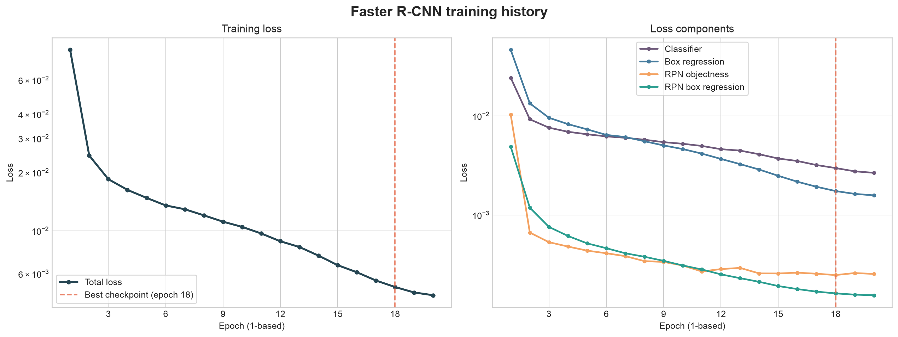

첫 에폭의 total loss는 0.0858이었고 최적 체크포인트에서 0.0051로 감소해 약 **94.0% 줄었다.** 네 손실 구성 요소도 전반적으로 안정적으로 감소했다.

최적 체크포인트에서 loss 구성은 다음과 같다.

| Loss | 값 |
| --- | ---: |
| Classification | 0.002973 |
| Box regression | 0.001742 |
| RPN objectness | 0.000247 |
| RPN box regression | 0.000162 |

후반에는 classification loss가 가장 큰 비중을 차지하지만 절대값은 충분히 작다. 다만 손실 감소만으로 checkpoint를 선택하면 안 된다. 19~20번째 에폭에서 loss는 더 낮아졌지만 검증 성능은 오히려 나빠졌다.

### 5.2 Validation 지표

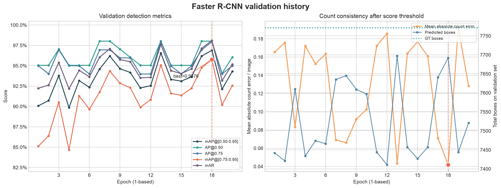

| 학습 순서 | Train loss | mAP | AP@0.50 | AP@0.75 | mAP@[0.75:0.95] | mAR | Recall@0.50 | 개수 오차/이미지 |
| ---: | ---: | ---: | ---: | ---: | ---: | ---: | ---: | ---: |
| 1 | 0.0858 | 0.9007 | 0.9505 | 0.9499 | 0.8510 | 0.9223 | 0.9564 | 0.1654 |
| 3 | 0.0185 | 0.9377 | 0.9703 | 0.9695 | 0.9052 | 0.9540 | 0.9776 | 0.0834 |
| 8 | 0.0120 | 0.9618 | 0.9802 | 0.9694 | 0.9435 | 0.9709 | 0.9821 | 0.0661 |
| 13 | 0.0082 | 0.9655 | 0.9802 | 0.9797 | 0.9509 | 0.9761 | 0.9873 | 0.0434 |
| **18 (best)** | **0.0051** | **0.9689** | **0.9802** | **0.9793** | **0.9576** | **0.9811** | **0.9889** | **0.0420** |
| 19 | 0.0048 | 0.9212 | 0.9406 | 0.9399 | 0.9019 | 0.9316 | 0.9480 | 0.1920 |
| 20 | 0.0046 | 0.9431 | 0.9604 | 0.9499 | 0.9257 | 0.9518 | 0.9628 | 0.1283 |

해석은 다음과 같다.

- 1번째에서 18번째 에폭 사이 COCO mAP는 0.9007에서 0.9689로 **6.81%p 상승**했다.
- 엄격한 위치 정확도를 반영하는 mAP@[0.75:0.95]는 0.8510에서 0.9576으로 **10.66%p 상승**했다.
- AP@0.50과 AP@0.75가 각각 0.9802, 0.9793으로 거의 같다. 단순히 알약을 찾는 데 그치지 않고 대부분의 bbox가 IoU 0.75 조건도 만족한다는 뜻이다.
- 19번째 에폭에서 모든 validation 지표가 크게 하락했고 20번째에도 최고 수준을 회복하지 못했다. 학습 loss는 계속 감소했으므로, 이 실행에서는 train loss보다 validation의 고 IoU mAP를 checkpoint 선택 기준으로 삼은 것이 타당하다.
- validation 곡선은 에폭별 진폭이 있는 편이다. 후속 실험에서는 seed를 달리한 반복 실행 또는 학습률·scheduler 조정으로 최고점의 재현성을 확인해야 한다.

### 5.3 Score threshold와 개수 일치도

최적 에폭의 score threshold 전후 결과는 다음과 같다. 여기서 `전`은 torchvision 모델 내부 후처리를 통과한 결과이고, `후`는 파이프라인의 추가 score 0.25 조건까지 적용한 결과다.

| 항목 | Score 0.25 적용 전 | Score 0.25 적용 후 |
| --- | ---: | ---: |
| 예측 bbox 수 | 7,693 | 7,692 |
| Recall@IoU 0.50 | 0.9891 | 0.9889 |
| 이미지당 개수 절대 오차 | 0.0415 | 0.0420 |

추가 threshold가 제거한 bbox는 validation 전체에서 1개뿐이다. 즉 예측 대부분의 score가 이미 0.25보다 높으며, 현재 결과에서 threshold 0.25의 영향은 거의 없다. Validation GT 7,771개에 대해 threshold 적용 후 예측은 7,692개로 총량은 79개 적고, 이미지별 절대 개수 오차의 합은 85개다. 따라서 남은 오류는 과다 탐지보다 누락 쪽의 영향이 더 크다고 볼 수 있다.

단, mAP 계열 지표는 추가 score 0.25 필터를 적용하지 않은 모델 예측으로 계산한다. Threshold 표는 실제 파이프라인에서 사용할 개수와 recall을 별도로 확인하기 위한 지표다.

### 5.4 정성 결과 예시

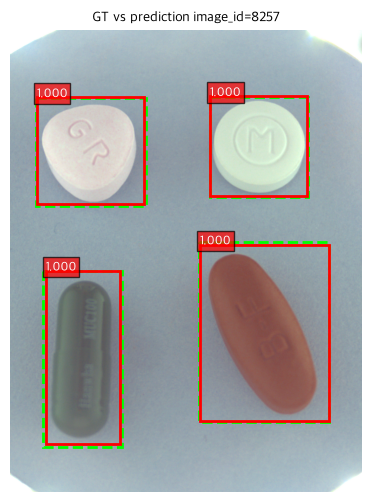

초록 점선은 GT, 빨간 실선은 예측 bbox다. 예시 이미지에서는 네 알약이 모두 score 1.000으로 검출됐고 예측 bbox가 GT와 거의 겹친다. 정량 지표의 높은 AP@0.75와 일관되는 사례다.

이 한 장만으로 전체 오류 경향을 일반화할 수는 없다. 남은 누락과 위치 오차는 낮은 점수 순, IoU 0.75 미만 순으로 별도 시각화해 확인해야 한다.

## 6. 실행 시간

노트북의 tqdm 완료 기록을 합산한 결과다. 데이터 준비, 체크포인트 직렬화 등 진행 표시 밖의 시간은 포함하지 않는다.

| 구간 | 평균/에폭 | 20에폭 합계 |
| --- | ---: | ---: |
| Train | 약 32분 50초 | 약 10시간 57분 |
| Validation | 약 3분 56초 | 약 1시간 19분 |
| 합계 | 약 36분 46초 | 약 12시간 15분 |

384/640 입력 크기로도 목표였던 20분/에폭보다 느렸다. 정확도는 높지만 반복 실험 비용이 큰 설정이므로, 이후에는 전체 20에폭을 매번 수행하기보다 소규모 pilot에서 설정을 거른 뒤 본 학습을 수행하는 편이 효율적이다.

## 7. 탐지기 단독 결론과 후속 작업

이번 실행의 Faster R-CNN은 validation에서 높은 탐지율과 bbox 위치 정밀도를 보였다. 특히 고 IoU mAP 0.9576과 threshold 적용 후 recall 0.9889를 기록해 후속 분류기로 crop을 전달하는 탐지기로 사용할 수 있는 수준이다.

우선순위가 높은 후속 작업은 다음과 같다.

1. End-to-end 검증에는 `last.pt`가 아니라 `best.pt`를 사용한다.
2. 누락·낮은 IoU·중복 탐지 이미지는 아래 end-to-end 분석처럼 유형별로 분리해 확인한다.
3. 동일 split에서 seed 반복 또는 learning rate 조정을 수행해 후반 validation 변동의 재현 여부를 확인한다.
4. 학습 시간을 줄이려면 설정 탐색은 일부 데이터나 짧은 에폭으로 수행하고, 확정 설정만 전체 데이터로 학습한다.
5. 실제 제출 또는 운영 threshold는 end-to-end 지표와 오류 비용을 기준으로 다시 정한다.

## 8. 재현 및 산출물

학습 진입점은 `notebooks/baseline/train_detector.ipynb`이며 실행 산출물은 아래 디렉터리에 저장됐다.

```text
outputs/detector/20261104-fasterrcnn-r50-fpn-v2-det-default-baseline-02/
├── best.pt
├── last.pt
├── metrics.csv
├── resolved_config.json
├── data_summary.json
├── label_map.json
├── val_predictions.json
├── error_samples.json
└── visualizations/
```

- `best.pt`: 고 IoU mAP를 1차 기준, mAR을 동률 기준으로 선택한 최적 checkpoint
- `last.pt`: 20번째 에폭 종료 상태와 재개용 optimizer/scheduler 상태
- `metrics.csv`: 본 보고서의 학습·검증 그래프와 표의 원본
- `resolved_config.json`: 실제 실행에 적용된 설정
- `val_predictions.json`: validation 예측 상세 분석용 원본

## 9. End-to-End Validation 결과

### 9.1 실행 구성과 평가 방법

탐지기 `best.pt`가 만든 bbox crop을 ResNet-50 분류기에 전달해 위치와 세부 약품 category를 함께 평가했다.

```text
validation image
  → Faster R-CNN pill detection
  → predicted bbox crop
  → ResNet-50 medicine classification
  → category_id + detector_score × classifier_score
```

| 구분 | 설정 |
| --- | --- |
| End-to-end 실행 | `20261104-fasterrcnn-resnet50-infer-test-full-v2-01` |
| Detector 실행 | `20261104-fasterrcnn-r50-fpn-v2-det-default-baseline-02` |
| Detector checkpoint | `best.pt` |
| Classifier 실행 | `resnet50_baseline_v2` |
| Classifier | ResNet-50, 118개 category |
| 실행 장치 | MPS (`device=auto`에서 선택) |
| 추론 batch size | 4 |
| Detector score threshold | 0.25 |
| 진단용 matching IoU | 0.50 |
| 최종 점수 | `detector_score × classifier_score` |

오류 status는 이미지별 예측을 최종 점수 순으로 정렬한 뒤 아직 연결되지 않은 GT 중 IoU가 가장 높은 대상을 선택해 결정한다.

| Status | 의미 |
| --- | --- |
| `correct` | IoU 0.50 이상이고 category도 일치 |
| `misclassified` | IoU 0.50 이상이지만 category 불일치 |
| `false_positive` | 어떤 미매칭 GT와도 IoU 0.50 이상으로 연결되지 않은 예측 |
| `false_negative` | 끝까지 예측과 연결되지 않은 GT |

Category-aware AP는 예측 category와 최종 점수를 사용하므로 bbox 위치와 약품 분류가 모두 맞아야 true positive가 된다.

### 9.2 전체 결과

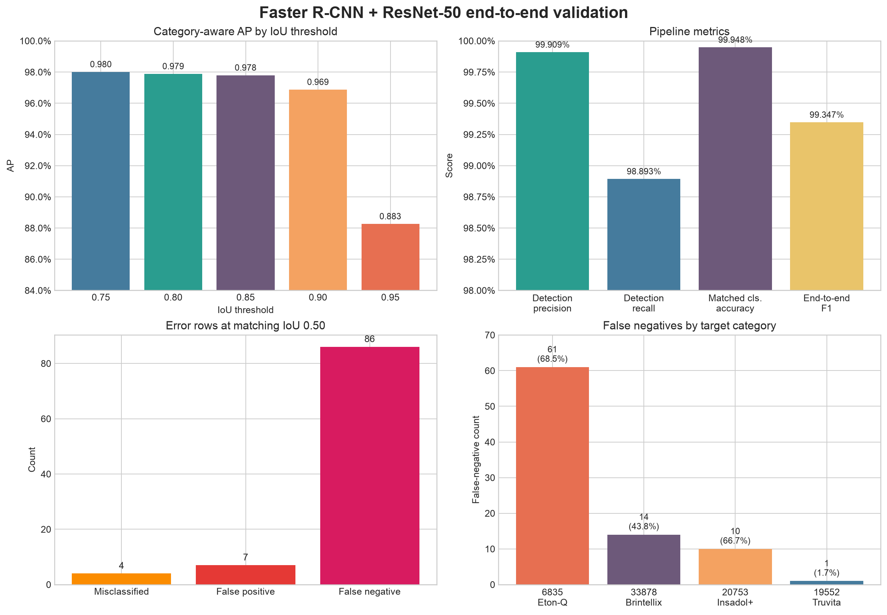

| 지표 | 결과 |
| --- | ---: |
| Validation 이미지 | 2,026 |
| GT 알약 | 7,771 |
| 최종 예측 | 7,692 |
| IoU 0.50 이상 탐지 매칭 | 7,685 |
| Category까지 맞춘 최종 정답 | 7,681 |
| Detection precision | 0.9991 |
| Detection recall | 0.9889 |
| 매칭 bbox 분류 정확도 | 0.9995 |
| End-to-end precision | 0.9986 |
| End-to-end recall | 0.9884 |
| End-to-end F1 | **0.9935** |
| Category-aware mAP@[0.75:0.95] | **0.9577** |
| Mean average recall | 0.9665 |

탐지 bbox가 GT와 연결된 7,685건 중 category 오답은 4건뿐이다. 따라서 정상적인 crop이 분류기에 전달되면 99.95%를 맞혔으며, 전체 오류의 중심은 분류보다 탐지 누락에 있다.

탐지기 단독 고 IoU mAP 0.9576과 category-aware end-to-end mAP 0.9577은 수치상 거의 같다. 두 평가는 label과 score 정의가 달라 절대값을 완전히 같은 척도로 간주할 수는 없지만, 매칭 bbox 분류 정확도 0.9995와 분류 오답 4건을 함께 보면 분류 오답이 전체 AP에 미치는 영향은 작고 현재 end-to-end 성능은 주로 탐지 결과에 의해 결정된다고 해석할 수 있다.

### 9.3 IoU threshold별 AP와 위치 정확도

| IoU threshold | Category-aware AP |
| --- | ---: |
| 0.75 | 0.9801 |
| 0.80 | 0.9789 |
| 0.85 | 0.9780 |
| 0.90 | 0.9688 |
| 0.95 | 0.8826 |
| 평균 0.75:0.95 | **0.9577** |

AP@0.90까지 0.96 이상을 유지해 대다수 bbox의 위치 정확도는 높다. AP@0.95에서는 0.8826으로 하락하지만 이전 threshold와 비교해도 여전히 높은 편이다.

IoU 0.50 이상으로 매칭된 bbox의 분포도 이를 뒷받침한다.

| 구간 | IoU |
| --- | ---: |
| 최솟값 | 0.5037 |
| 1 percentile | 0.9131 |
| 5 percentile | 0.9477 |
| 중앙값 | 0.9755 |
| 95 percentile | 0.9897 |
| 최댓값 | 0.9981 |

중앙값이 0.9755이므로 탐지에 성공한 알약의 bbox는 대부분 GT와 매우 가깝다. 개선 우선순위는 이미 찾은 bbox를 조금 더 정밀하게 다듬는 것보다, 특정 외형의 알약을 아예 놓치는 FN을 줄이는 쪽에 있다.

### 9.4 오류 구성

| Status | 오류 행 수 | 포함 이미지 수 |
| --- | ---: | ---: |
| Misclassified | 4 | 4 |
| False positive | 7 | 6 |
| False negative | 86 | 86 |
| 전체 오류 | 97 | 92개 고유 이미지 |

FP와 FN이 같은 이미지에 함께 존재하므로 status별 이미지 수를 단순 합산하면 고유 이미지 수보다 커진다. 아래 시각화에서는 92개 오답 이미지를 중복 없이 분류 오답 4장, FP 포함 6장, FN-only 82장으로 나눴다.

색상은 모든 그림에서 동일하다.

- 초록 점선: GT bbox
- 파란 실선: category까지 맞춘 예측
- 빨간 실선: false positive
- 주황 실선: misclassified
- 자홍 점선: false negative GT

### 9.5 분류 오답

| image_id | 정답 | 예측 | IoU | Classifier score |
| ---: | --- | --- | ---: | ---: |
| 8351 | 엘스테인캡슐 | 뮤코원캡슐 | 0.9320 | 0.5749 |
| 8370 | 엘스테인캡슐 | 알바스테인캡슐 | 0.9505 | 0.8368 |
| 8386 | 뮤코원캡슐 | 엘스테인캡슐 | 0.9455 | 0.5070 |
| 8834 | 엘스테인캡슐 | 뮤코원캡슐 | 0.9520 | 0.5262 |

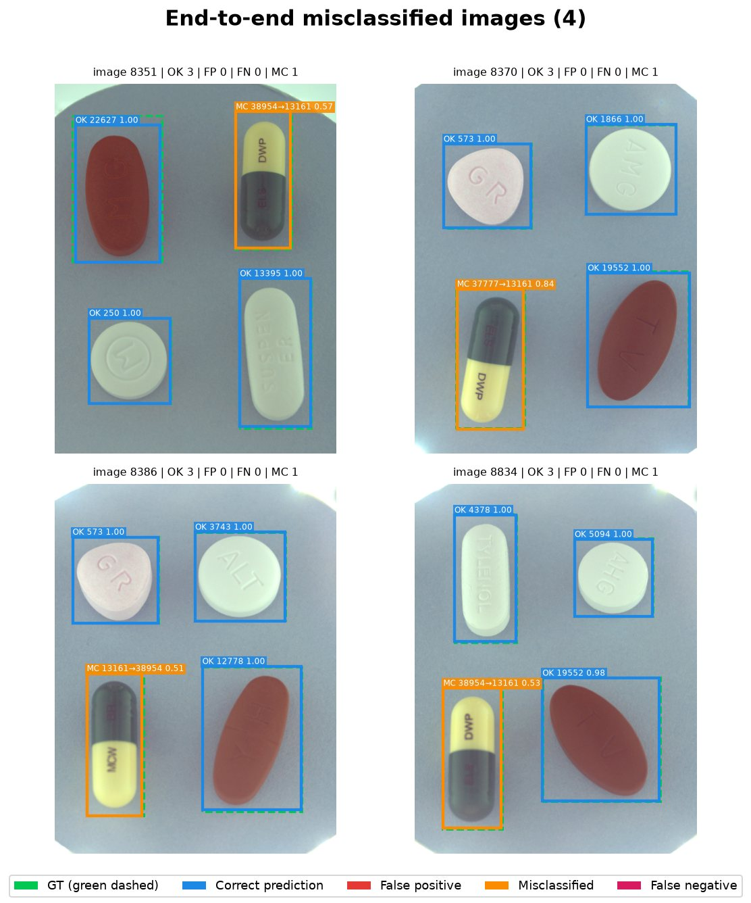

네 건 모두 bbox IoU가 0.93 이상이므로 detector 위치 오류가 아니다. 또한 정답과 예측이 모두 에르도스테인 캡슐 계열이며 외형과 각인 구성이 매우 유사하다. 세 건의 classifier score가 0.58 미만이고 한 건만 0.8368이므로, 분류기가 높은 확신으로 전혀 다른 품목을 선택한 형태보다는 유사 품목 사이의 경계가 불안정한 사례로 보는 것이 적절하다.

### 9.6 False positive

| image_id | 예측 category | Detector score | Final score | 형태 |
| ---: | --- | ---: | ---: | --- |
| 8312 | 트루비타정 | 0.9942 | 0.9520 | 동일 알약 중복·부분 bbox |
| 8958 | 트루비타정 | 0.9827 | 0.9697 | 동일 알약 중복·부분 bbox |
| 9150 | 인사돌플러스정 | 0.9989 | 0.9986 | GT와 위치 불일치, FN 동반 |
| 9153 | 인사돌플러스정 | 0.9915 | 0.9915 | GT와 위치 불일치, FN 동반 |
| 9206 | 이튼큐정 | 0.5633 | 0.5632 | 부분 bbox, FN 동반 |
| 9534 | 트루비타정 2건 | 0.9993 / 0.2889 | 0.9959 / 0.2849 | 중복·부분 bbox, FN 동반 |

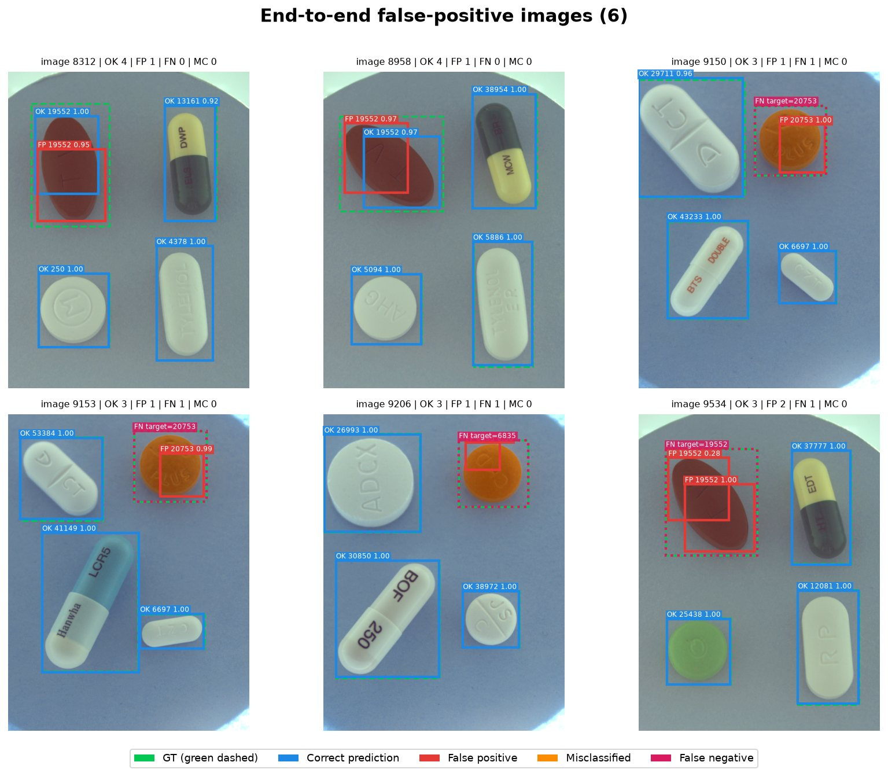

FP 7개 중 6개는 detector score가 0.56 이상이며 5개는 0.98 이상이다. 따라서 score threshold를 조금 높이는 것만으로는 대부분 제거되지 않는다. 그림에서 image 8312와 8958은 같은 알약에 정상 bbox와 작은 중복 bbox가 함께 남았고, 나머지는 대상 알약의 일부만 감싸 IoU 0.50에 미달한 경우다. 후속 조정 대상은 score threshold보다 NMS와 bbox 회귀다.

### 9.7 False negative

FN 86개는 네 category에만 나타났으며, 그중 85개인 **98.8%가 세 category에 집중**됐다.

| Category ID | 품목 | Validation GT | FN | 품목 내 누락률 |
| ---: | --- | ---: | ---: | ---: |
| 6835 | 이튼큐정 | 89 | 61 | **68.5%** |
| 33878 | 브린텔릭스정 20MG | 32 | 14 | **43.8%** |
| 20753 | 인사돌플러스정 | 15 | 10 | **66.7%** |
| 19552 | 트루비타정 | 59 | 1 | 1.7% |

이는 전체 recall 0.9889만 보면 드러나지 않는 체계적인 오류다. 동일 이미지의 다른 알약은 대부분 정상적으로 탐지하면서 위 품목만 반복해서 건너뛰므로, 이미지 전체의 조명이나 로딩 실패보다 특정 외형에 대한 objectness 사각지대로 해석하는 편이 타당하다.

브린텔릭스정의 GT bbox 중앙 면적은 약 34,043px²로 전체 GT 중앙값 약 84,949px²보다 작아 입력 축소 후 크기가 누락에 영향을 줬을 가능성이 있다. 반면 이튼큐정과 인사돌플러스정의 중앙 면적은 각각 약 74,513px², 81,780px²로 전체 중앙값과 크게 다르지 않다. 따라서 세 품목의 누락을 입력 크기 하나로만 설명할 수는 없다. 두 원형 주황색 품목의 반복 누락은 색상·형태·각인과 학습 표본 구성이 함께 만든 외형 편향일 가능성이 있으나, 이는 추가 실험으로 확인해야 한다.

Score 0.25 적용 전후 detector recall 차이는 약 0.0001이고 매칭 예측은 한 개만 줄었다. 따라서 외부 score threshold를 낮추는 것만으로는 86개 FN 문제를 해결할 수 없다.

#### FN-only 이미지 1–20

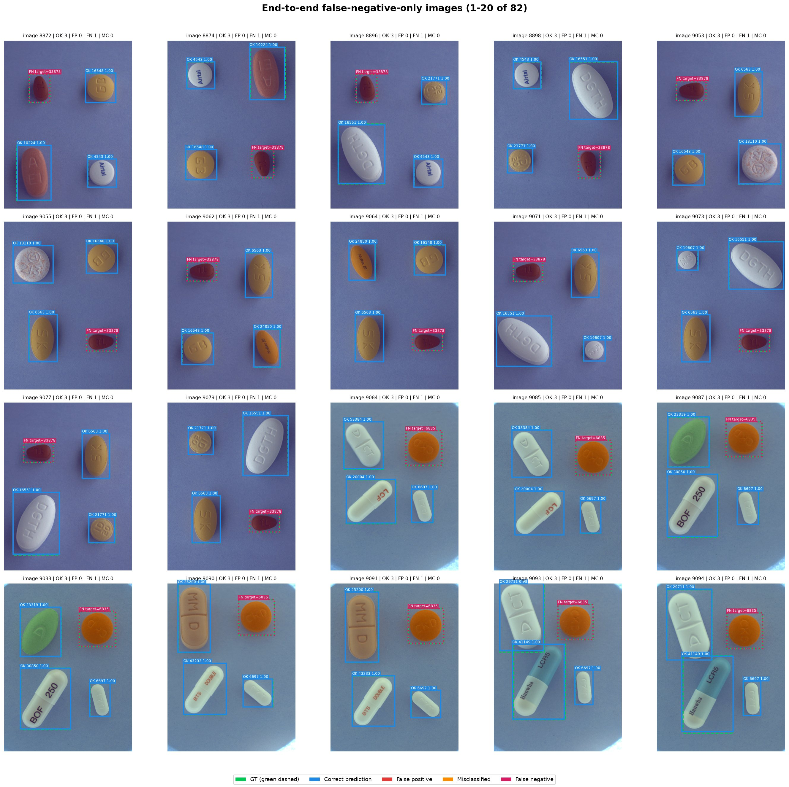

#### FN-only 이미지 21–40

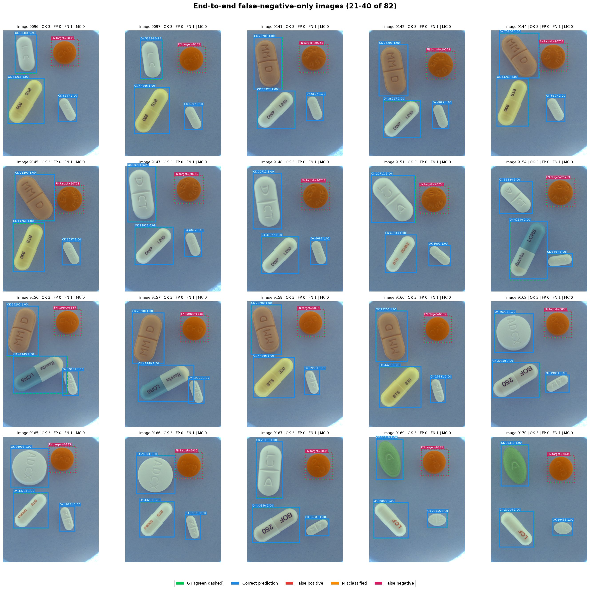

#### FN-only 이미지 41–60

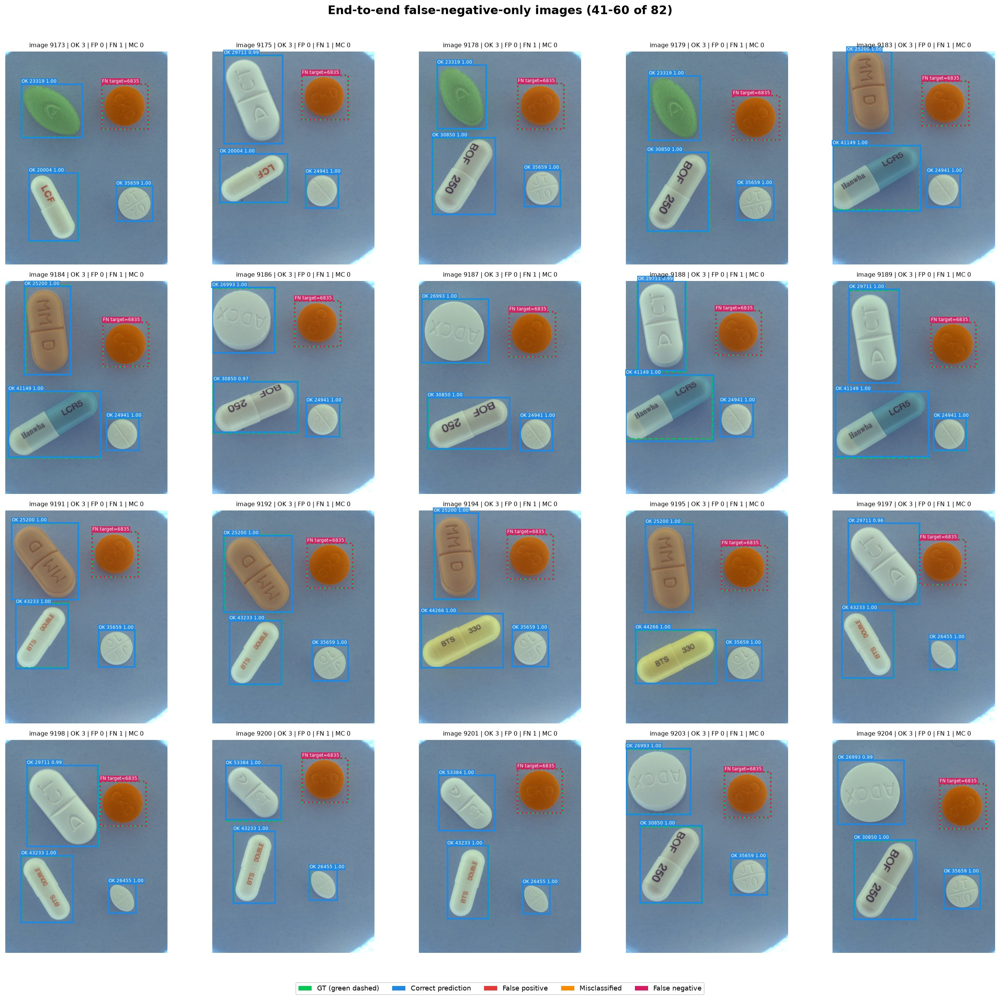

#### FN-only 이미지 61–80

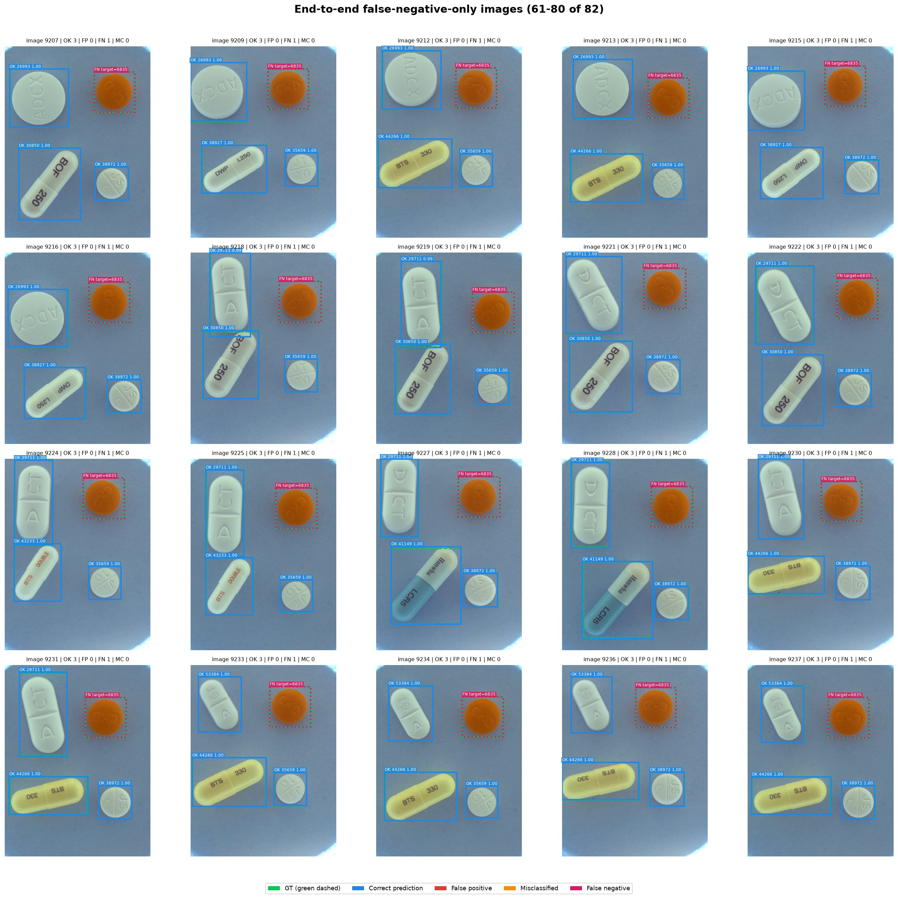

#### FN-only 이미지 81–82

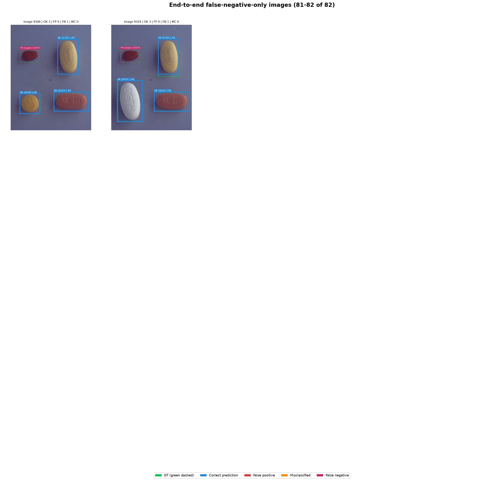

### 9.8 End-to-End 결론과 우선 작업

Faster R-CNN과 ResNet-50 연결 자체는 정상이며 전체 F1 0.9935, category-aware mAP@[0.75:0.95] 0.9577을 기록했다. 탐지된 crop의 분류 정확도도 0.9995로 높다. 그러나 세 품목에 FN이 집중돼 있으므로 현재 상태를 모든 품목에 균등하게 안정적인 모델이라고 평가해서는 안 된다.

후속 작업의 우선순위는 다음과 같다.

1. 이튼큐정·브린텔릭스정·인사돌플러스정의 train 표본과 annotation을 우선 재검수한다.
2. 세 품목이 포함된 이미지를 oversampling하거나, 색상·밝기·scale 증강을 제한적으로 적용해 FN 변화를 측정한다.
3. 브린텔릭스정처럼 상대적으로 작은 알약은 더 큰 내부 입력 크기 또는 작은 객체 중심 설정을 짧은 pilot으로 검증한다.
4. 중복·부분 bbox 7개는 NMS threshold와 proposal/bbox 설정을 조정하되, recall 저하 여부를 함께 확인한다.
5. 에르도스테인 캡슐 세 품목은 classifier의 confusion matrix와 crop 원본을 별도로 비교한다.
6. 전체 평균뿐 아니라 품목별 detector recall을 정식 평가 산출물에 추가한다.

### 9.9 End-to-End 산출물

```text
outputs/inference/20261104-fasterrcnn-resnet50-infer-test-full-v2-01/
├── submission.csv
├── pill_predictions.json
├── pill_recognition_errors.json
├── resolved_config.json
└── validation/
    ├── validation_metrics.json
    ├── validation_details.csv
    └── false_positive_images_grid.png
```

- `validation_metrics.json`: 본 절의 전체 지표 원본
- `validation_details.csv`: 예측·GT 매칭과 status별 상세 행
- `submission.csv`: Kaggle 제출 형식의 test 예측 3,225행
- 보고서의 오답 그림: `reports/figures/faster_rcnn/end_to_end/`
