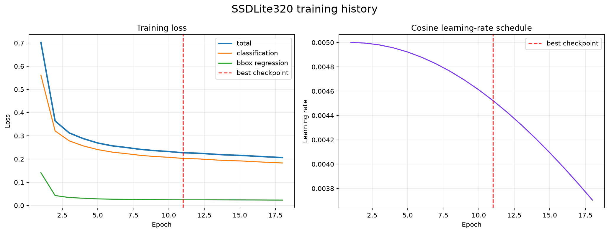
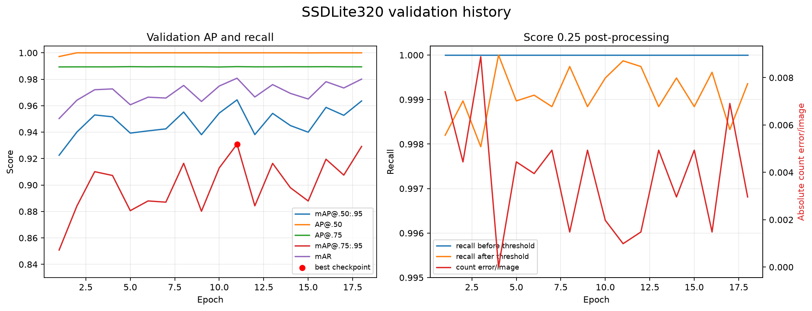
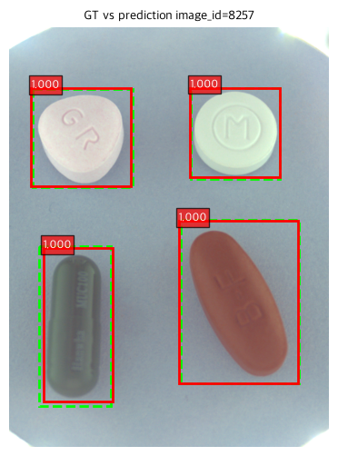
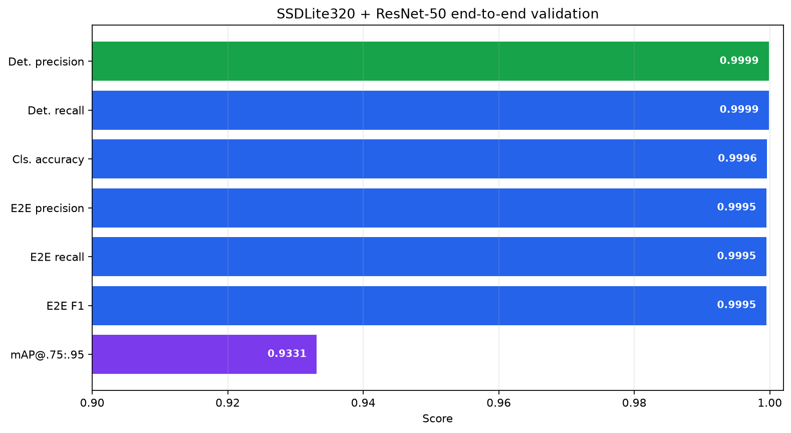
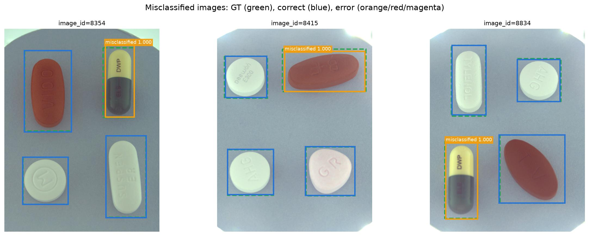
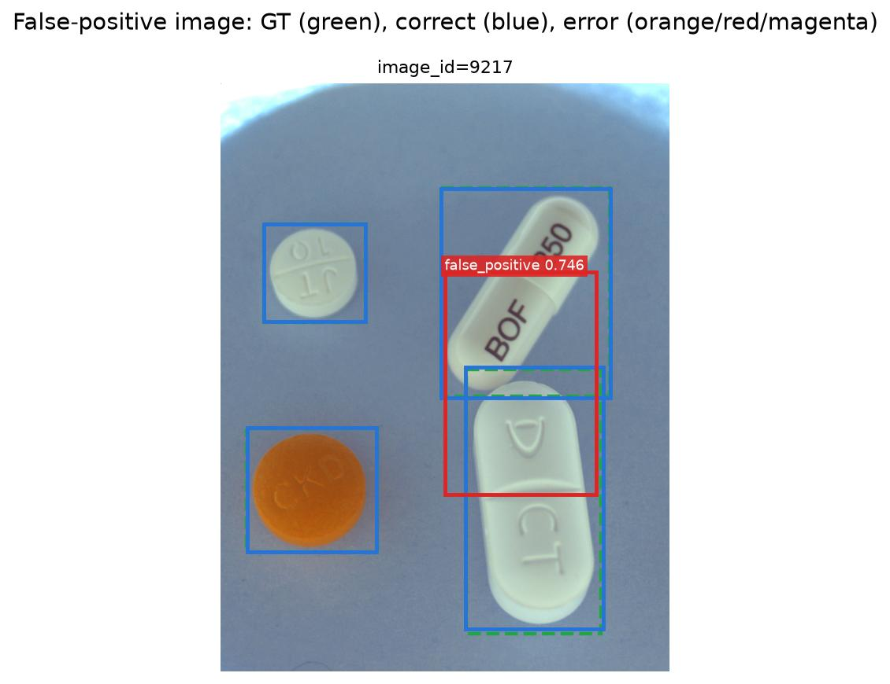
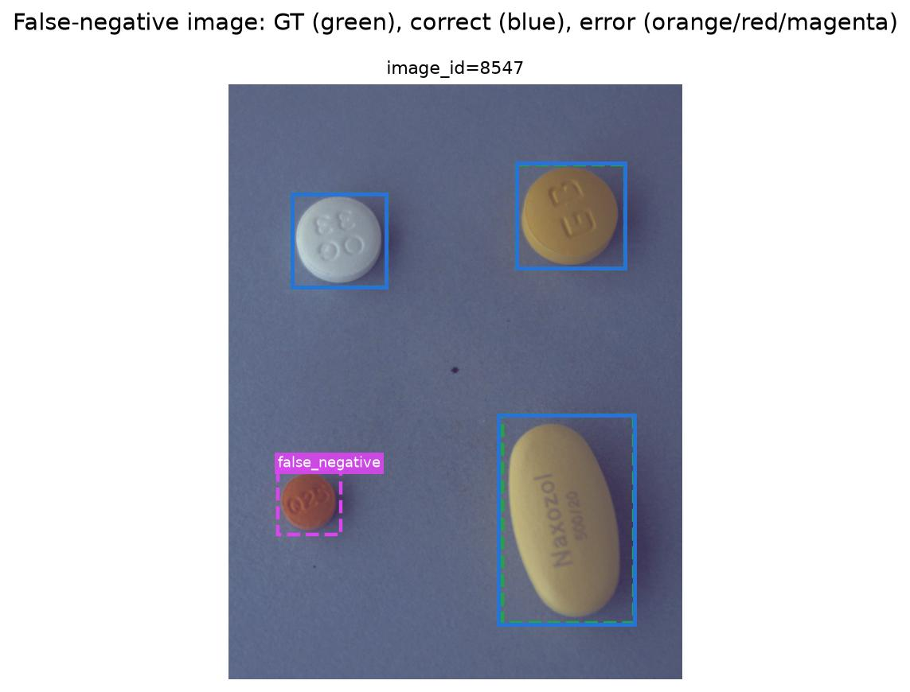

# SSDLite320 알약 탐지기 학습 결과 보고서

> 작성일: 2026-11-05
> 탐지기 실행 이름: `20261104-ssdlite320-det-default-baseline-01`
> End-to-end 실행 이름: `20261105-ssdlite320-resnet50-infer-test-full-01`
> 분석 기준: `best.pt`, `last.pt`, `metrics.csv`, `data_summary.json`, `resolved_config.json`, end-to-end validation 산출물

## 1. 요약

SSDLite320 MobileNetV3-Large를 단일 클래스 알약 탐지기로 학습했다. 최대 50에폭으로 설정했지만 validation 고 IoU mAP가 7에폭 동안 최고 기록을 갱신하지 않아 **18번째 에폭에서 조기 종료**됐다. 최적 checkpoint는 CSV와 checkpoint에서 0부터 세는 `epoch=10`, 즉 **11번째 에폭**이다.

| 핵심 항목 | 결과 |
| --- | ---: |
| 모델 파라미터 | 3,708,680개 |
| Detector COCO mAP@[0.50:0.95] | **0.9644** |
| Detector AP@0.50 | **1.0000** |
| Detector AP@0.75 | **0.9895** |
| Detector 고 IoU mAP@[0.75:0.95] | **0.9309** |
| Detector mean average recall | **0.9808** |
| Score 0.25 적용 후 recall@0.50 | **0.9999** |
| 학습·검증 진행 표시 기준 총시간 | 약 1시간 37분 |
| End-to-end F1 | **0.9995** |
| Category-aware mAP@[0.75:0.95] | **0.9331** |

`best.pt`와 ResNet-50 분류기를 연결한 현재 validation에서는 GT 7,771개 중 7,770개를 탐지했다. 최종 오류는 분류 오답 3개, FP 1개, FN 1개다.

FN은 작은 알약을 전혀 찾지 못한 것이 아니다. 모델이 IoU 0.9247의 bbox를 score 0.2331로 예측했지만 현재 threshold 0.25에서 제거됐다. 반면 FP는 서로 가까운 두 알약을 하나의 큰 bbox로 합친 score 0.7464의 예측이다. 따라서 두 오류를 하나의 score threshold 변경으로 동시에 해결하기는 어렵다.

본 보고서의 수치는 제외 데이터와 정리된 현재 split을 반영한 학습 및 추론 결과다. 정제 전 결과는 현재 모델 비교에 사용하지 않는다.

## 2. 목적과 모델 구조

SSDLite320의 역할은 조합 이미지에서 모든 알약의 위치를 빠르게 찾는 것이다. 모델 클래스는 background `0`, pill `1` 두 개이며 세부 약품 category는 bbox crop을 전달받은 별도 분류기가 결정한다.

```text
input image
  → model internal normalization and 320 × 320 resize
  → MobileNetV3-Large backbone
  → multi-scale feature maps
  → depthwise-separable SSDLite heads
  → anchor classification + bbox regression
  → score filtering + NMS
  → pill boxes
  → ResNet-50 classifier
  → medicine category
```

- 모델: `ssdlite320_mobilenet_v3_large`
- Backbone: MobileNetV3-Large
- Backbone 초기값: ImageNet `IMAGENET1K_V1`
- 전체 COCO 탐지 가중치: 사용하지 않음
- Detection head: 현재 pill 데이터로 학습
- 내부 입력 크기: 320 × 320 고정
- 파라미터: 3,708,680개
- 최적 checkpoint 크기: 약 28.7MiB

SSD 계열은 여러 크기와 비율의 기본 anchor를 각 위치에 배치한 뒤 class score와 bbox 보정값을 동시에 예측한다. SSDLite는 detection head의 일반 convolution을 depthwise-separable convolution으로 줄여 연산량과 모델 크기를 낮춘 구조다.

## 3. 데이터 구성

| 항목 | Train | Validation |
| --- | ---: | ---: |
| 이미지 수 | 8,143 | 2,026 |
| bbox 수 | 31,238 | 7,771 |
| 그룹 수 | 2,869 | 716 |
| 이미지당 최대 bbox 수 | 4 | 4 |
| 빈 이미지 수 | 0 | 0 |

- Train/validation 그룹 중복: 0
- 좌표 보정된 bbox: 0
- Split hash: `2d72625caef7f3bca75df6957fb3dcfa8e1abb038d3dc799839f3102b2f549f1`

Faster R-CNN과 YOLO26s 실험에 사용한 현재 detector split과 동일하다. DataLoader는 원본 크기의 이미지와 bbox를 전달하고 320 × 320 resize 및 좌표 변환은 torchvision 모델 내부 transform이 담당한다.

## 4. 학습 설정

| 항목 | 설정 |
| --- | --- |
| Device | MPS |
| Batch size | 4 |
| Max epochs | 50 |
| 실제 실행 epochs | 18 |
| Optimizer | SGD |
| Initial learning rate | 0.005 |
| Momentum | 0.9 |
| Weight decay | 0.0005 |
| Scheduler | CosineAnnealingLR, `T_max=50` |
| Score threshold | 0.25 |
| NMS threshold | 0.45 |
| Early stopping patience | 7 |
| Seed | 42 |
| 학습 증강 | 사용하지 않음 |

Scheduler 주기가 최대 50에폭에 맞춰져 있지만 학습은 18에폭에서 조기 종료됐다. 따라서 learning rate는 초기 0.005에서 최종 약 0.00370까지만 감소했다. Validation 고 IoU mAP 변동이 큰 점을 고려하면 후속 실험에서는 예상 학습 길이에 맞춘 더 짧은 cosine 주기 또는 learning rate 조정이 필요하다.

## 5. 탐지기 학습 결과

### 5.1 학습 손실



| Loss | 1번째 에폭 | 최적 11번째 에폭 | 마지막 18번째 에폭 |
| --- | ---: | ---: | ---: |
| Total | 0.702151 | 0.227073 | 0.206424 |
| Classification | 0.561011 | 0.202658 | 0.183150 |
| Bbox regression | 0.141141 | 0.024415 | 0.023274 |

1번째에서 최적 checkpoint 사이 total loss는 약 **67.7% 감소**했다. 마지막 에폭에서는 0.2064까지 더 낮아졌지만 checkpoint 선택 기준인 고 IoU mAP는 최적 에폭보다 낮았다. 따라서 train loss만 보고 `last.pt`를 선택하면 안 되며 후속 추론에는 `best.pt`를 사용해야 한다.

Classification loss가 최종 loss의 대부분을 차지한다. 단일 foreground 클래스 학습이라도 SSD anchor 대부분이 background이므로, classification 항에는 많은 anchor의 foreground/background 판별이 포함된다.

### 5.2 Validation 지표



| 학습 순서 | Train loss | COCO mAP | AP@0.50 | AP@0.75 | mAP@[0.75:0.95] | mAR | Recall@0.50 |
| ---: | ---: | ---: | ---: | ---: | ---: | ---: | ---: |
| 1 | 0.7022 | 0.9225 | 0.9972 | 0.9893 | 0.8508 | 0.9503 | 0.9982 |
| 3 | 0.3123 | 0.9530 | 1.0000 | 0.9894 | 0.9101 | 0.9721 | 0.9979 |
| 5 | 0.2692 | 0.9393 | 1.0000 | 0.9895 | 0.8806 | 0.9607 | 0.9990 |
| 8 | 0.2418 | 0.9552 | 1.0000 | 0.9894 | 0.9164 | 0.9753 | 0.9997 |
| **11 (best)** | **0.2271** | **0.9644** | **1.0000** | **0.9895** | **0.9309** | **0.9808** | **0.9999** |
| 12 | 0.2253 | 0.9381 | 1.0000 | 0.9894 | 0.8843 | 0.9666 | 0.9997 |
| 15 | 0.2160 | 0.9400 | 0.9999 | 0.9894 | 0.8879 | 0.9650 | 0.9988 |
| 18 | 0.2064 | 0.9636 | 1.0000 | 0.9894 | 0.9292 | 0.9801 | 0.9994 |

해석은 다음과 같다.

- 1번째에서 11번째 에폭 사이 COCO mAP는 0.9225에서 0.9644로 **4.19%p 상승**했다.
- 엄격한 위치 정확도를 반영하는 mAP@[0.75:0.95]는 0.8508에서 0.9309로 **8.01%p 상승**했다.
- AP@0.50과 AP@0.75는 초반부터 각각 약 1.0, 0.989로 안정적이다. 알약의 존재를 찾는 능력은 일찍 포화됐고 이후 차이는 주로 높은 IoU 구간의 bbox 정밀도에서 발생했다.
- 고 IoU mAP는 에폭별 진폭이 크다. 예를 들어 11번째 0.9309에서 12번째 0.8843으로 하락했다가 18번째 0.9292까지 회복했다.
- Train loss는 계속 감소했지만 validation 지표는 단조롭게 상승하지 않았다. `best.pt`를 따로 저장하고 patience 7을 적용한 것이 유효했다.

### 5.3 Score threshold의 영향

최적 11번째 에폭의 score threshold 전후 결과는 다음과 같다.

| 항목 | Score 0.25 적용 전 | Score 0.25 적용 후 |
| --- | ---: | ---: |
| 예측 bbox 수 | 124,128 | 7,771 |
| Recall@IoU 0.50 | 1.0000 | 0.9999 |
| 이미지당 개수 절대 오차 | 57.4319개 | 0.0010개 |

SSD는 dense anchor에서 많은 저점수 후보를 생성한다. Score 0.25를 적용하기 전에는 validation 이미지 한 장당 평균 61개가 넘는 후보가 남지만, 적용 후 GT와 같은 총 7,771개로 줄어든다. 즉 현재 SSDLite 결과에서는 score threshold가 선택 사항이 아니라 필수 후처리다.

Threshold 적용으로 recall이 1.0000에서 0.9999로 약간 감소했다. 9.6절에서 확인한 FN 1개가 이 과정에서 제거된 사례다.

### 5.4 정성 결과 예시



초록 점선은 GT, 빨간 실선은 예측 bbox다. image 8257의 네 알약이 모두 score 1.000으로 검출됐다. 예측은 GT와 전반적으로 잘 겹치지만 320px 입력의 영향으로 일부 bbox 경계에는 작은 차이가 남는다.

## 6. 실행 시간

노트북의 tqdm 완료 기록을 합산한 결과다. 데이터 준비와 checkpoint 저장 시간은 포함하지 않는다.

| 구간 | 평균/에폭 | 18에폭 합계 |
| --- | ---: | ---: |
| Train | 약 4분 31초 | 약 1시간 21분 26초 |
| Validation | 약 52초 | 약 15분 28초 |
| 합계 | 약 5분 23초 | 약 1시간 36분 54초 |

최적 checkpoint를 다시 평가한 final validation은 약 52초가 추가로 소요됐다. 18에폭에서 조기 종료돼 최대 50에폭을 모두 수행하는 비용도 발생하지 않았다.

## 7. 탐지기 단독 결론과 후속 작업

SSDLite320은 작은 모델과 320px 입력으로도 AP@0.50 1.0000, AP@0.75 0.9895를 기록해 알약 존재 여부 탐지는 안정적이다. 다만 mAP@[0.75:0.95]는 0.9309로, 매우 엄격한 bbox 겹침 조건에서는 위치 오차가 남는다.

우선순위가 높은 후속 작업은 다음과 같다.

1. 추론에는 `last.pt`가 아니라 11번째 에폭의 `best.pt`를 사용한다.
2. FN이 된 소형 알약은 score 0.2331이므로 threshold 0.23 전후를 짧게 재평가한다.
3. Threshold를 낮추면 dense anchor FP가 늘 수 있으므로 전체 validation의 FP와 mAP를 함께 확인한다.
4. 인접한 두 알약을 하나로 묶은 FP는 threshold보다 anchor, NMS, 입력 해상도 또는 후처리 규칙을 점검한다.
5. 고 IoU mAP의 에폭별 변동을 줄이기 위해 learning rate, scheduler 주기와 seed 반복을 실험한다.
6. 작은 객체 위치 정밀도가 중요하다면 320px 고정 입력의 구조적 한계를 고려한다.

## 8. 재현 및 탐지기 산출물

학습 진입점은 `notebooks/baseline/train_detector.ipynb`이며 실행 산출물은 아래 디렉터리에 저장됐다.

```text
outputs/detector/20261104-ssdlite320-det-default-baseline-01/
├── best.pt
├── last.pt
├── metrics.csv
├── resolved_config.json
├── data_summary.json
├── label_map.json
├── val_predictions.json
├── error_samples.json
└── visualizations/
    └── image-8257.png
```

- `best.pt`: 고 IoU mAP를 1차 기준, mAR을 동률 기준으로 선택한 11번째 에폭 checkpoint
- `last.pt`: 조기 종료 시점인 18번째 에폭 checkpoint와 optimizer/scheduler 상태
- `metrics.csv`: 에폭별 학습 손실, validation 지표와 threshold 전후 결과
- `resolved_config.json`: 실제 학습에 적용된 설정
- `val_predictions.json`: `best.pt`와 score 0.25를 적용한 validation 예측 7,771개

## 9. End-to-End Validation 결과

### 9.1 실행 구성과 평가 방법

SSDLite320의 bbox crop을 ResNet-50 분류기에 전달해 위치와 세부 약품 category를 함께 평가했다.

```text
validation image
  → SSDLite320 pill detection
  → predicted bbox crop
  → ResNet-50 medicine classification
  → category_id + detector_score × classifier_score
```

| 구분 | 설정 |
| --- | --- |
| End-to-end 실행 | `20261105-ssdlite320-resnet50-infer-test-full-01` |
| Detector 실행 | `20261104-ssdlite320-det-default-baseline-01` |
| Detector checkpoint | `best.pt` |
| Classifier 실행 | `resnet50_baseline_v2` |
| Classifier | ResNet-50, 118개 category |
| 실행 장치 | MPS |
| 추론 batch size | 4 |
| Detector score threshold | 0.25 |
| 진단용 matching IoU | 0.50 |
| 최종 점수 | `detector_score × classifier_score` |

오류 status는 이미지별 예측과 GT를 IoU 0.50 기준으로 연결해 결정했다.

| Status | 의미 |
| --- | --- |
| `correct` | IoU 0.50 이상이고 category도 일치 |
| `misclassified` | IoU 0.50 이상이지만 category 불일치 |
| `false_positive` | 어떤 미매칭 GT와도 IoU 0.50 이상으로 연결되지 않은 예측 |
| `false_negative` | 끝까지 예측과 연결되지 않은 GT |

Category-aware AP는 bbox 위치뿐 아니라 분류기가 예측한 category와 최종 점수를 사용한다. 단일 `pill` 클래스로 계산한 탐지기 학습 mAP와 평가 대상이 다르다.

### 9.2 전체 결과



| 지표 | 결과 |
| --- | ---: |
| Validation 이미지 | 2,026 |
| GT 알약 | 7,771 |
| 최종 예측 | 7,771 |
| IoU 0.50 이상 탐지 매칭 | 7,770 |
| Category까지 맞춘 최종 정답 | 7,767 |
| Detection precision | 0.9999 |
| Detection recall | 0.9999 |
| 매칭 bbox 분류 정확도 | 0.9996 |
| End-to-end precision | 0.9995 |
| End-to-end recall | 0.9995 |
| End-to-end F1 | **0.9995** |
| Category-aware mAP@[0.75:0.95] | **0.9331** |
| Mean average recall | 0.9532 |

예측 수와 GT 수는 모두 7,771개지만 구성은 완전히 같지 않다. GT 한 개가 누락되고 별도의 FP 한 개가 추가되어 탐지 매칭은 7,770개다. 그중 category 오답이 3개이므로 최종 정답은 7,767개다.

F1은 0.9995로 높지만 고 IoU mAP는 0.9331이다. 이는 객체 수와 category는 대부분 맞더라도 bbox가 GT와 거의 완전히 겹쳐야 하는 조건에서는 320px 입력의 위치 오차가 더 크게 반영되기 때문이다.

### 9.3 IoU threshold별 category-aware AP와 위치 정확도

| IoU threshold | Category-aware AP |
| --- | ---: |
| 0.75 | 0.9971 |
| 0.80 | 0.9955 |
| 0.85 | 0.9910 |
| 0.90 | 0.9768 |
| 0.95 | 0.7053 |
| 평균 0.75:0.95 | **0.9331** |

AP@0.90까지는 0.97 이상이지만 AP@0.95에서 0.7053으로 크게 하락한다. 대부분의 bbox는 충분히 정확하지만 픽셀 단위로 거의 일치해야 하는 조건에서는 경계 차이가 남는다는 뜻이다.

IoU 0.50 이상으로 매칭된 7,770개 bbox의 분포는 다음과 같다.

| 구간 | IoU |
| --- | ---: |
| 최솟값 | 0.6663 |
| 1 percentile | 0.8972 |
| 5 percentile | 0.9311 |
| 중앙값 | 0.9668 |
| 95 percentile | 0.9852 |
| 99 percentile | 0.9899 |
| 최댓값 | 0.9979 |

중앙값은 0.9668로 높지만 IoU 0.95보다 약간 높은 수준이다. AP@0.95에서는 중앙값 이하의 많은 예측이 탈락하므로 앞선 급락과 일관된다.

### 9.4 오류 구성

| Status | 오류 행 수 | 포함 이미지 수 |
| --- | ---: | ---: |
| Misclassified | 3 | 3 |
| False positive | 1 | 1 |
| False negative | 1 | 1 |
| 전체 오류 | 5 | 5 |

그림의 색상은 다음과 같다.

- 초록 점선: GT bbox
- 파란 실선: category까지 맞춘 예측
- 빨간 실선: false positive
- 주황 실선: misclassified
- 자홍 점선: false negative GT

### 9.5 분류 오답

| image_id | 정답 | 예측 | IoU | Classifier score |
| ---: | --- | --- | ---: | ---: |
| 8354 | 엘스테인캡슐 | 뮤코원캡슐 | 0.8834 | 0.6627 |
| 8415 | 삐콤씨에프정 | 넥시움정 40MG | 0.9024 | 0.5878 |
| 8834 | 엘스테인캡슐 | 뮤코원캡슐 | 0.9445 | 0.5397 |



세 건 모두 bbox IoU가 0.88 이상이고 detector score가 약 1.0이므로 탐지 누락이나 잘못된 crop 위치가 주원인은 아니다.

두 건은 외형이 매우 유사한 에르도스테인 캡슐인 엘스테인캡슐을 뮤코원캡슐로 분류했다. 나머지 한 건은 붉은 장방형 삐콤씨에프정을 넥시움정으로 분류했다. 세 classifier score가 0.54~0.66이므로 높은 확신의 오답보다는 유사 외형 품목 사이의 결정 경계 사례로 보는 것이 적절하다.

### 9.6 False positive

| image_id | Detector score | 예측 형태 |
| ---: | ---: | --- |
| 9217 | 0.7464 | 인접한 두 알약의 일부를 하나로 합친 큰 bbox |



FP bbox는 비오플250캡슐과 디카테오정이 세로로 가까이 배치된 영역을 함께 감싼다. 각 GT와 IoU는 각각 0.3754, 0.3058이라 어느 쪽에도 매칭되지 않았다. 같은 두 알약의 정상 bbox도 별도로 존재하므로 중복·병합형 FP다.

FP detector score는 0.7464로 낮지 않다. Threshold를 0.80으로 올리면 이 FP는 제거되지만 정상 매칭도 7,770개에서 7,741개로 29개 줄어든다. 따라서 score threshold 상향은 적절한 단독 해결책이 아니며 NMS, anchor 또는 인접 객체 후처리를 먼저 검토해야 한다.

### 9.7 False negative

| image_id | 정답 품목 | GT 크기 | 원시 예측 score | 원시 예측 IoU |
| ---: | --- | ---: | ---: | ---: |
| 8547 | 쿠에타핀정 25MG | 136 × 140px | 0.2331 | 0.9247 |



이 알약의 bbox 면적은 19,040px²이며 현재 validation GT 중 하위 약 **0.18 percentile**에 해당한다. 전체 GT 중앙 면적 84,949px²의 약 22%다. 320px로 축소하면 상대적으로 작은 객체이므로 낮은 score에 영향을 줬을 가능성이 있다.

중요한 점은 모델이 위치를 놓친 것이 아니라는 것이다. Score threshold 적용 전 예측에는 IoU 0.9247의 정확한 bbox가 있었지만 score 0.2331로 현재 기준 0.25보다 0.0169 낮아 제거됐다. Threshold를 0.23 정도로 낮추면 이 사례는 복구될 가능성이 높지만 전체 validation의 저점수 FP 증가량을 다시 계산해야 한다.

### 9.8 Score 분포와 threshold 해석

최종 예측 7,771개의 detector score 중앙값은 1.0이고 5 percentile도 약 0.99997다. 반면 정상 매칭의 최솟값은 0.2550이며 누락된 소형 알약은 0.2331이다. 예측 점수가 대부분 1.0 부근에 포화되고 일부 어려운 객체만 낮은 점수를 갖는 형태다.

현재 threshold 0.25는 전체 개수와 precision을 매우 잘 맞추지만 경계에 걸린 소형 객체 한 개를 제거한다. 다음 threshold 실험은 넓은 범위를 탐색하기보다 `0.22`, `0.23`, `0.24`, `0.25`처럼 현재 경계 주변을 세밀하게 비교하는 편이 효율적이다.

### 9.9 End-to-End 결론과 후속 작업

SSDLite320과 ResNet-50 연결은 정상적으로 동작했으며 F1 0.9995, category-aware mAP@[0.75:0.95] 0.9331을 기록했다. 객체 존재와 category 기준 오류는 5건뿐이지만 IoU 0.95 성능이 상대적으로 낮아 bbox 위치 정밀도가 최종 mAP를 제한한다.

후속 작업의 우선순위는 다음과 같다.

1. Threshold 0.22~0.25 구간을 재평가해 소형 알약 FN 복구와 추가 FP 수를 함께 비교한다.
2. 병합형 FP는 score 상향 대신 NMS와 인접 객체 사례의 anchor 예측을 분석한다.
3. 작은 객체와 엄격한 bbox 정확도가 중요하면 더 큰 입력 크기를 지원하는 다른 detector와 함께 비교한다.
4. 엘스테인캡슐·뮤코원캡슐과 붉은 장방형 정제는 분류기 confusion matrix와 crop 원본을 점검한다.
5. Validation 고 IoU mAP 변동을 줄이도록 learning rate와 cosine scheduler 주기를 조정한다.
6. Kaggle 점수는 본 로컬 validation 결과와 별도로 기록해 제출 형식 또는 test 분포 차이를 구분한다.

### 9.10 End-to-End 산출물

```text
outputs/inference/20261105-ssdlite320-resnet50-infer-test-full-01/
├── submission.csv
├── pill_predictions.json
├── pill_recognition_errors.json
├── resolved_config.json
└── validation/
    ├── validation_metrics.json
    ├── validation_details.csv
    └── false_positive_images_grid.png
```

- `validation_metrics.json`: 본 절의 전체 지표 원본
- `validation_details.csv`: 예측·GT 매칭과 status별 상세 행
- `submission.csv`: Kaggle 제출 형식의 test 예측 3,229행, 842개 이미지
- 보고서의 정리된 그림: `reports/figures/ssdlite320/`
- 이 실행의 Kaggle leaderboard 점수는 별도로 기록하지 않음

## 10. 별도 증강 A1 실험

기준 실행과 별도로, Colab L4 환경에서 같은 탐지기 v2 패키지를 사용해
SSDLite320 기준선과 증강 A1을 비교했다. 이 비교에 사용한 두 실행은 서로 같은
`split_hash`(`ac6618cdf2fd69352b0d3848b69064eadbc6527d6153795c3cc2de1c2dfa7d32`)를
공유한다. 다만 앞 절의 MPS 기준 실행에 기록된 hash와 다르므로, A1 결과는 두 Colab
실행 사이의 비교로만 해석하고 앞 절의 절대 지표를 대체하지 않는다.

### 10.1 실험 설정

| 항목 | Colab 기준선 | A1 |
| --- | --- | --- |
| 실행 이름 | `20261104-ssdlite320-det-v2-baseline-01` | `20261104-ssdlite320-det-v2-aug-flipcolor-01` |
| 좌우 / 상하 뒤집기 | 0 / 0 | 0.5 / 0.5 |
| 밝기 / 대비 | 0 / 0 | 0.15 / 0.20 |
| Early stopping patience | 7 | 10 |
| 최대 / 실제 epoch | 50 / 23 | 50 / 50 |
| Best epoch | 16 | 44 |

두 실행은 SSDLite320, SGD, 초기 learning rate 0.005, momentum 0.9,
weight decay 0.0005, batch size 8, seed 42를 공통으로 사용했다. A1은 촬영 방향과
밝기 변화에 대응하도록 뒤집기와 약한 색상 변화를 적용했고, 흐림·회전·크기 변화는
추가하지 않았다.

Patience와 실제 학습 길이도 함께 달라졌기 때문에 아래 차이를 증강만의 인과 효과로
분리할 수는 없다. A1은 증강과 더 긴 학습 정책을 함께 적용한 후보로 평가했다.

### 10.2 Validation 결과

| 지표 | Colab 기준선 | A1 | 차이 |
| --- | ---: | ---: | ---: |
| Best mAP@[0.75:0.95] | 0.9402 | 0.9498 | +0.0096 |
| 상위 3 epoch 평균 | 0.9382 | 0.9489 | +0.0107 |
| COCO mAP@[0.50:0.95] | 0.9691 | 0.9739 | +0.0048 |
| AP@0.95 | 0.7495 | 0.7844 | +0.0349 |
| Mean average recall | 0.9837 | 0.9870 | +0.0033 |
| Score 0.25 적용 후 예측 수 | 7,767 | 7,770 | +3 |

AP@0.75~0.90은 두 실행이 거의 같았고, 개선 폭은 주로 엄격한 AP@0.95에서
나타났다. 하지만 실험 전에 정한 채택 기준인 best mAP@[0.75:0.95] `+0.01`에는
0.0004 부족했다. A1은 최대 50 epoch까지 학습해 기준선보다 계산 비용도 컸다.

### 10.3 Kaggle 결과와 판단

두 탐지기에 같은 ResNet-50 분류기와 최종 score threshold 0.05를 연결해 제출했다.

| 실행 | Kaggle Public score |
| --- | ---: |
| Colab 기준선 `sub03_det_v2` | 0.58765 |
| A1 `sub11_det_v2_aug_a1` | 0.58430 |

A1은 validation AP@0.95가 상승했지만 Public score는 0.00335 낮았다. 이 차이만으로
증강이 test 성능을 저하시켰다고 단정할 수는 없지만, 사전 채택 기준에도 미달했고
추가 학습 비용도 발생했으므로 최종 설정으로 채택하지 않았다.

재현 시 별도 Colab 전용 노트북을 사용하지 않는다. 공통
[`train_detector.ipynb`](../../notebooks/baseline/train_detector.ipynb) 또는
`main.py train-detector`에서 `configs/detector.yaml`의 모델, 증강, patience와
실행 경로만 명시적으로 바꿔 같은 학습 경로를 사용한다.
