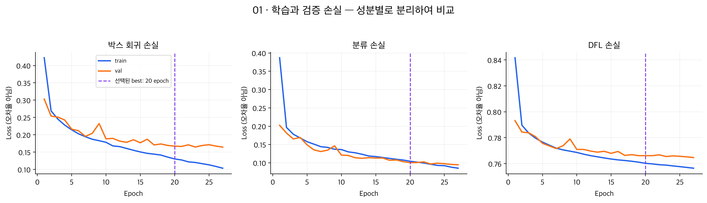
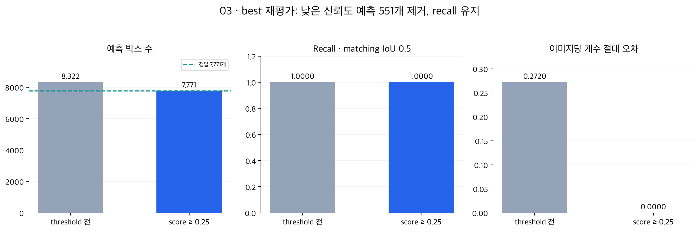

# YOLO11s · 탐지기 v2 · 공통 분류기 e2e 및 Kaggle 결과

이 문서는 2026-11-03~04에 수행한 실험의 결과 기록이다. PR 정리 과정에서
전체 모델을 다시 학습하거나 Kaggle에 추가 제출하지 않았다.

## 데이터·학습

| 항목 | 실제 실행 |
| --- | --- |
| Train / val | 8,143장·31,238개 / 2,026장·7,771개 |
| split_hash | `ac6618cdf2fd69352b0d3848b69064eadbc6527d6153795c3cc2de1c2dfa7d32` |
| 초기 모델 | COCO 사전학습 `yolo11s.pt`, 단일 pill 클래스 |
| 입력 / 증강 | 640 letterbox / 명시적 학습 증강 비활성 |
| 장치·환경 | Tesla T4 · Python 3.13.16 · torch 2.11.0+cu130 · Ultralytics 8.4.183 |
| Optimizer / LR | SGD · 초기 0.005 · momentum 0.9 · cosine · warmup 0 |
| Batch | AutoBatch 목표 0.7 → 실제 33장 · 기울기 누적 2회 |
| Weight decay | 요청 0.0005 · decay group 실효값 0.000515625 |
| Seed / patience | 42 / 7 |
| 최대 / 실제 epoch | 50 / 27 |
| Best | 20 epoch · 고 IoU mAP 우선, 동률 시 MAR@100 |
| 탐지 run | `20261103-yolo11s-det-v2-baseline-01` |

Train과 val은 고정 분할을 유지했다. 학습·검증 손실은 처음보다 감소했으며
후반 val 개선이 작아졌다. 20 epoch 이후 선택 기준이 7 epoch 동안 개선되지 않아 종료했다.

| val loss | 1 epoch | 27 epoch |
| --- | ---: | ---: |
| box | 0.30327 | 0.16445 |
| cls | 0.20244 | 0.09463 |
| dfl | 0.79315 | 0.76468 |

손실은 오답 비율이 아니며 성분끼리 숫자 크기를 비교하지 않는다. 이 곡선만으로
심한 과적합을 단정하지 않는다.

## 탐지기 단독 best 재평가

| 지표 | 값 |
| --- | ---: |
| COCO mAP@[0.50:0.95] | 0.992074 |
| 고 IoU mAP@[0.75:0.95] | 0.986151 |
| MAR@100 | 0.997581 |
| score 0.25 후 recall (matching IoU 0.5) | 1.000000 |
| score 0.25 후 이미지당 개수 절대 오차 | 0.000000 |

NMS 후 conf >= 0.001 예측은 8,322개였다. Score >= 0.25로 7,771개를 남겨
recall을 유지했다. 현재 val·IoU 0.5에서 미탐/추가 탐지가 없는 결과로 해석하지만
픽셀 단위 완벽한 박스나 새 환경의 무오류를 뜻하지 않는다.

학습 중 20 epoch의 고 IoU mAP는 0.98365, best 파일 재평가는 0.986151이었다.
추가 학습은 없었다. Precision·batch·padding 등 평가 조건 차이의 영향 가능성은 있으나
원인은 미확정이다. 모델 비교 전 평가 조건을 통일해야 한다.

## 공통 ResNet50 연결 e2e

분류기는 `models/classifier/resnet50_baseline_v2/best_v2_slim.pt`와 같은 폴더의
`class_map.json`을 사용했다. YOLO 예측 박스로 crop하며 두 모델을 다시 학습하지 않았다.

| 전체 val 2,026장·118종 | mAP@[0.75:0.95] | AP@0.95 | 예측 수 |
| --- | ---: | ---: | ---: |
| 탐지 score >= 0.25 | 0.990965 | 0.968636 | 7,771 |
| 최종 score >= 0.25 | 0.990965 | 0.968636 | 7,771 |

최종 score는 탐지 score * 분류 확률이다. AP는 GT에 있는 약품 클래스별로 평균했다.
Reference COCO 평가이며 팀/대회 scorer와의 동일성 및 팀 threshold 위치는 미확인이다.
공통 분류기 자체의 별도 평가와 이번 e2e 평가는 다른 결과다.

탐지기 단독 AP와 e2e AP는 평균 대상과 score 순위가 달라 숫자를 직접 빼서
분류기를 붙인 성능 변화로 해석하지 않는다. Val은 탐지기 모델 선택에 사용했으므로
독립 test 성능이 아니다.

## Kaggle 제출

| 항목 | 기록 |
| --- | --- |
| 대회 | ai15-level1-project |
| 제출 실행 | `20261104-yolo11s-resnet50-infer-test-submission-01` |
| 날짜 | 2026-11-04 · 정확한 시각 미기록 |
| 파일 / 상태 | `submission.csv` / Complete |
| Public score | **0.60831** |
| Private score | 기록 없음 |

제출 메시지: `YOLO11s best epoch20 + shared resnet50 v2; detector threshold 0.25`

사용자가 제공한 Kaggle 제출 완료 화면과 결과 파일을 근거로 기록했다. Test에는 정답이
공개돼 있지 않아 로컬 점수는 계산하지 않았다. Public 점수는 Private 점수와 구분한다.
Val과 Kaggle 점수 차이는 데이터·채점 방식·좌표/ID/score 처리 등을 점검해야 하며
차이의 원인을 이번 기록만으로 확정하지 않는다.

## 보존 경로와 후속 확인

Drive `gitkk_archive/outputs/detector/<탐지 run>/`에 weights, results.csv,
best_validation/evaluation.json, environment.json, resources.json을 보존한다.
E2e/제출 결과는 `gitkk_archive/outputs/inference/<해당 run>/`에 보존한다.
분류기와 class map은 `gitkk_archive/models/classifier/resnet50_baseline_v2/`에 있다.

이 저장소에는 가중치·데이터·cache·전체 예측 CSV·소스 ZIP을 올리지 않는다.
공유한 두 그래프는 원래 결과 파일에서 생성한 요약이다. 새 YOLO11s 실행은
공통 [`YoloDetectorConfig`](../../configs/yolo_detector.py)의 `model_name`을
`yolo11s.pt`로 지정하고 [`train_yolo_detector()`](../../detector/yolo_training.py)를
호출한다. 통합 검증과 제출 파일 생성은
[`run_pill_recognition.ipynb`](../../notebooks/baseline/run_pill_recognition.ipynb)의
`detector_backend`를 `ultralytics`로 설정해 같은 공통 경로에서 수행한다.

- 동일 공통 분류기·평가 조건으로 SSDLite/Faster R-CNN 비교
- 팀 공통 scorer 및 threshold 위치 확인
- AP@0.95가 낮은 약품의 위치 오차와 오분류 사례 확인
- Val과 Kaggle 차이 원인을 좁히기 위한 test 예측/제출 형식 점검
