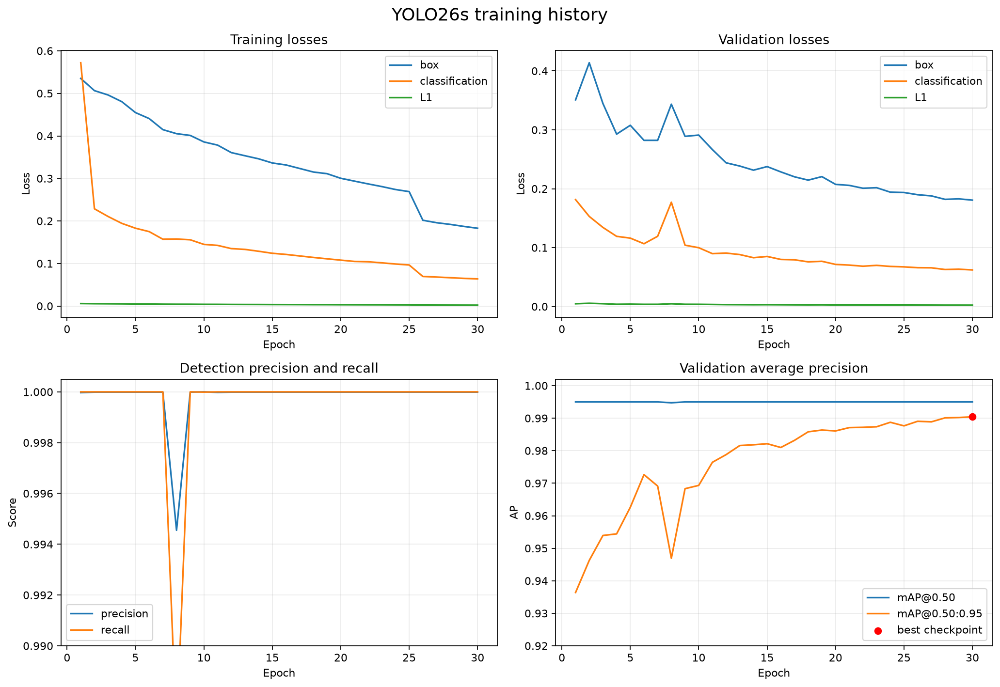
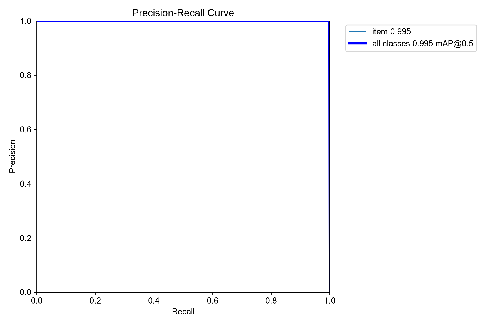
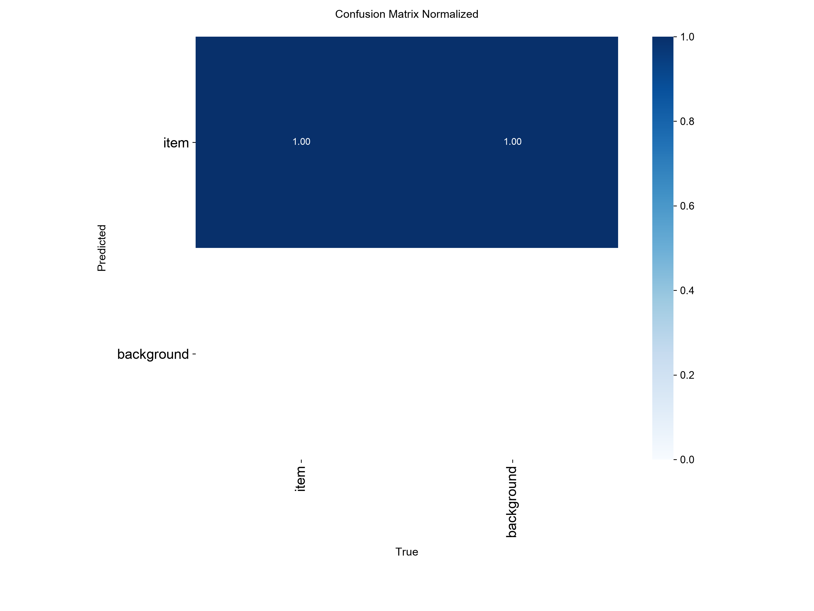
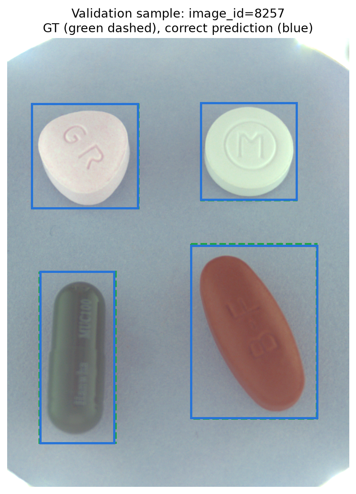
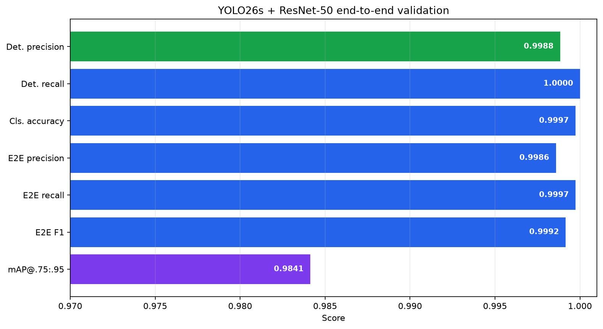
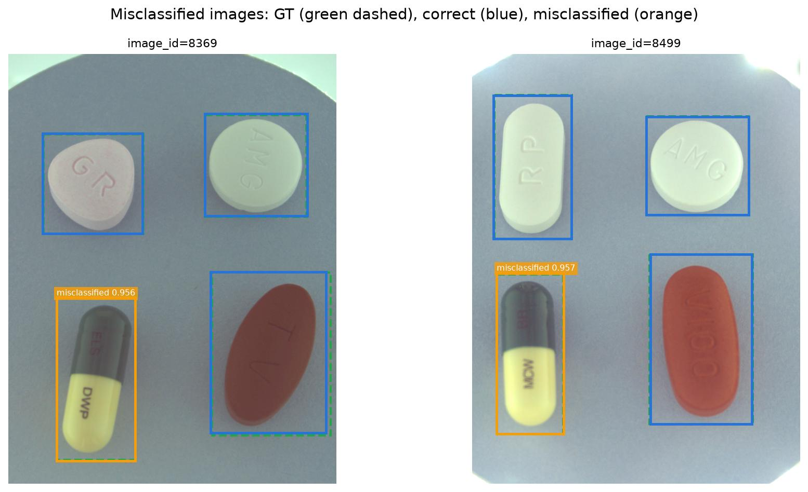
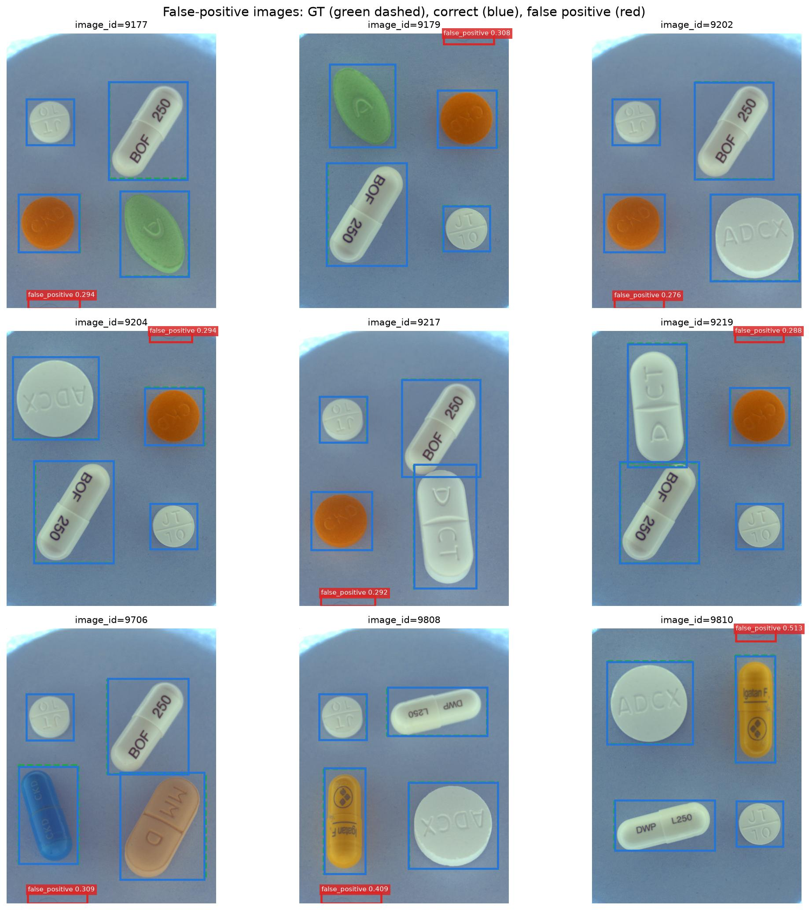

# YOLO26s 알약 탐지기 학습 결과 보고서

> 작성일: 2026-11-04
> 탐지기 실행 이름: `20261104-yolo26s-det-default-baseline-01`
> End-to-end 실행 이름: `20261104-yolo26s-resnet50-infer-test-full-01`
> 분석 기준: `weights/best.pt`, `results.csv`, `data_summary.json`, `resolved_config.json`, end-to-end validation 산출물

## 1. 요약

YOLO26s를 단일 클래스 알약 탐지기로 30에폭 학습했다. Ultralytics의 COCO 방식 validation mAP@[0.50:0.95]는 마지막 30번째 에폭에서 가장 높은 **0.9904**를 기록했으며, 해당 상태가 `weights/best.pt`에 저장됐다.

| 핵심 항목 | 결과 |
| --- | ---: |
| 모델 파라미터 | 9,948,638개 |
| 640px 기준 연산량 | 약 22.74 GFLOPs |
| Detector mAP@[0.50:0.95] | **0.9904** |
| Detector AP@0.50 | **0.9950** |
| Detector precision | **0.99999** |
| Detector recall | **1.0000** |
| 학습 시간 | 약 5시간 56분 |
| End-to-end F1 | **0.9992** |
| Category-aware mAP@[0.75:0.95] | **0.9841** |

탐지기와 ResNet-50 분류기를 연결한 validation에서는 GT 7,771개를 모두 탐지해 **FN이 0개**였다. 남은 오류는 분류 오답 2개와 이미지 위·아래 경계를 알약으로 본 FP 9개다. 분류 오답 2개도 서로 외형이 매우 유사한 에르도스테인 캡슐 간 상호 오답이었다.

현재 validation에서는 정상 매칭 예측의 최저 detector score가 0.9187이고 FP의 최고 score가 0.5128이었다. 따라서 score threshold를 0.55로 올리면 정상 매칭을 유지하면서 FP 9개를 모두 제거할 수 있다. 다만 이는 현재 validation에서 관찰한 결과이므로 test 제출 전에 threshold 변경 결과를 별도 실행으로 재확인해야 한다.

## 2. 목적과 모델 구조

YOLO26s의 역할은 조합 이미지에서 알약의 위치를 빠르게 찾는 것이다. 탐지 단계는 모든 알약을 하나의 `pill` 클래스로 취급하며, bbox crop을 받은 별도 분류기가 세부 약품 category를 결정한다.

```text
input image
  → resize to 640px input
  → convolution + C3k2 backbone
  → SPPF + C2PSA
  → upsample/concat multi-scale feature fusion
  → three-scale Detect head
  → score filtering
  → pill boxes
  → ResNet-50 classifier
  → medicine category
```

- 모델: `yolo26s.pt`
- 입력 크기: 640 × 640
- 탐지 클래스: 1개, 의미상 `pill`
- Backbone/neck 주요 블록: Conv, C3k2, SPPF, C2PSA, multi-scale feature fusion
- Detection head: 세 해상도의 특징맵을 사용하는 단일 클래스 Detect head
- 파라미터: 9,948,638개
- 연산량: 640px 입력 기준 약 22.74 GFLOPs
- 초기값: 사전 학습 `yolo26s.pt`
- 최적 가중치 크기: 약 20.3MB

YOLO 변환 데이터 내부 클래스 이름은 `item`으로 기록됐지만 `single_cls=True`로 학습하며, 프로젝트의 외부 label map에서는 동일한 클래스 ID `1`을 `pill`로 해석한다. 세부 약품 category는 탐지기 클래스가 아니라 후속 분류기의 class map에서 결정한다.

## 3. 데이터 구성

Faster R-CNN 실험과 같은 detector split을 YOLO 형식으로 변환해 사용했다.

| 항목 | Train | Validation |
| --- | ---: | ---: |
| 이미지 수 | 8,143 | 2,026 |
| bbox 수 | 31,238 | 7,771 |
| 그룹 수 | 2,869 | 716 |
| 이미지당 최대 bbox 수 | 4 | 4 |
| 빈 이미지 수 | 0 | 0 |

- Train/validation 그룹 중복: 0
- 좌표 보정된 bbox: 0
- Split hash: `2d72625caef7f3bca75df6957fb3dcfa8e1abb038d3dc799839f3102b2f549f1`

YOLO용 label txt와 dataset YAML은 원본 이미지와 annotation의 별도 정본이 아니다. 프로젝트의 detector 입력 패키지를 학습용으로 변환한 파생 산출물이므로 split과 bbox의 책임은 원본 `annotations.json`, `split_manifest.csv`에 있다.

## 4. 학습 설정

| 항목 | 설정 |
| --- | --- |
| Device | MPS |
| Batch size | 4 |
| Max epochs | 30 |
| Image size | 640 |
| Optimizer 설정 | `auto` |
| 실제 선택 optimizer | AdamW |
| 실제 initial learning rate | 0.002 |
| Momentum | 0.9 |
| Weight decay | 0.0005 |
| NMS IoU threshold | 0.45 |
| Early stopping patience | 7 |
| Seed | 42 |
| Workers | 0 |
| Cache images | 사용하지 않음 |

`optimizer=auto`에 따라 Ultralytics가 사용자가 입력한 기본 `lr0=0.01`을 그대로 쓰지 않고 AdamW와 learning rate 0.002를 선택했다. 재현 시에는 설정 파일뿐 아니라 실행 노트북의 optimizer 선택 로그도 함께 확인해야 한다.

### 4.1 학습 증강

| 증강 | 설정 |
| --- | ---: |
| Horizontal flip | 0.5 |
| Vertical flip | 0.5 |
| HSV hue | 0.015 |
| HSV saturation | 0.4 |
| HSV value | 0.2 |
| Translate | 0.1 |
| Scale | 0.3 |
| Mosaic | 0.5 |
| Close mosaic | 마지막 5에폭 |

알약은 촬영 방향이 고정된 객체가 아니므로 수평·수직 반전은 의미를 훼손하지 않는 증강으로 판단했다. Mosaic은 학습 후반 5에폭 동안 해제해 실제 이미지 분포에 맞춘 상태로 수렴하도록 했다.

## 5. 탐지기 학습 결과

### 5.1 학습 곡선



| 지표 | 1에폭 | 30에폭 | 변화 |
| --- | ---: | ---: | ---: |
| Train box loss | 0.53505 | 0.18291 | -65.8% |
| Train classification loss | 0.57202 | 0.06378 | -88.9% |
| Train L1 loss | 0.00582 | 0.00208 | -64.3% |
| Validation box loss | 0.35092 | 0.18066 | -48.5% |
| Validation classification loss | 0.18151 | 0.06213 | -65.8% |
| Validation L1 loss | 0.00469 | 0.00231 | -50.7% |

학습·검증 손실이 함께 감소하고 마지막 에폭에서 validation mAP도 최고점을 기록했다. train loss만 감소하고 validation이 악화되는 뚜렷한 과적합 신호는 확인되지 않았다.

26번째 에폭에서 box와 classification loss가 비교적 크게 낮아진 것은 마지막 5에폭의 Mosaic 비활성화 시점과 일치한다. 같은 시점부터 mAP가 다시 상승했으므로 현재 기록만 보면 오류라기보다 증강 스케줄 전환에 따른 변화로 해석하는 편이 타당하다.

### 5.2 Validation 지표

| 에폭 | Precision | Recall | AP@0.50 | mAP@[0.50:0.95] |
| ---: | ---: | ---: | ---: | ---: |
| 1 | 0.99997 | 1.00000 | 0.99500 | 0.93639 |
| 5 | 0.99999 | 1.00000 | 0.99500 | 0.96261 |
| 8 | 0.99455 | 0.98649 | 0.99474 | 0.94693 |
| 10 | 1.00000 | 0.99999 | 0.99500 | 0.96933 |
| 15 | 0.99999 | 1.00000 | 0.99500 | 0.98215 |
| 20 | 0.99999 | 1.00000 | 0.99500 | 0.98608 |
| 25 | 0.99999 | 1.00000 | 0.99500 | 0.98764 |
| **30 (best)** | **0.99999** | **1.00000** | **0.99500** | **0.99041** |

1번째에서 30번째 에폭 사이 mAP@[0.50:0.95]는 0.93639에서 0.99041로 **5.40%p 상승**했다. AP@0.50은 처음부터 0.995로 포화되어 있었지만 더 엄격한 IoU 구간을 함께 반영하는 mAP가 계속 상승했다. 따라서 후반 학습의 주된 효과는 알약 존재 여부를 새로 배우는 것보다 bbox 위치를 정밀하게 맞추는 데 있었다.

8번째 에폭에서 precision, recall, mAP가 일시적으로 하락했지만 다음 에폭부터 회복했고 같은 수준의 급락은 반복되지 않았다. 최종 checkpoint 선택은 학습 중 최고 mAP@[0.50:0.95]를 기록한 30번째 에폭이 타당하다.

### 5.3 PR curve와 confusion matrix





단일 클래스 기준 PR curve가 우측 상단에 가깝고 background와 pill 간 혼동도 매우 적다. 다만 Ultralytics의 학습 validation은 단일 `pill` 클래스만 평가하므로 약품 category가 맞는지는 이 결과로 판단할 수 없다. 세부 category를 포함한 성능은 9절의 end-to-end 결과를 봐야 한다.

### 5.4 정성 결과 예시



초록 점선은 GT, 파란 실선은 category까지 맞춘 최종 예측이다. image 8257의 네 알약 모두 GT와 거의 겹치며, 이후 계산한 전체 matched IoU 중앙값도 0.9784로 이 예시와 일관된다.

## 6. 실행 시간

`results.csv`의 누적 시간 기준 결과다.

| 항목 | 시간 |
| --- | ---: |
| 30에폭 누적 | 약 5시간 56분 31초 |
| 에폭당 평균 | 약 11분 53초 |

MPS 환경에서도 목표였던 에폭당 20분 안에 들어왔다. 학습 시간이 짧아진 만큼 threshold, 입력 크기, 증강 설정을 짧은 주기로 비교하기 적합하다. 다만 데이터 변환과 최초 모델 다운로드 등 학습 루프 밖의 시간은 이 값에 포함되지 않는다.

## 7. 탐지기 단독 결론과 후속 작업

YOLO26s는 validation에서 mAP@[0.50:0.95] 0.9904와 recall 1.0000을 기록했고, 30에폭까지 validation 성능이 개선됐다. 현재 데이터에서는 속도와 위치 정밀도를 함께 확보한 탐지기로 볼 수 있다.

우선순위가 높은 후속 작업은 다음과 같다.

1. 전체 추론에는 `weights/last.pt`가 아니라 최고 지표로 저장된 `weights/best.pt`를 사용한다.
2. 현재 validation에서 정상 예측과 FP score가 완전히 분리됐으므로 score threshold 0.55를 별도 실행으로 검증한다.
3. 경계 FP가 반복되는 원인을 확인하기 위해 이미지 위·아래의 촬영 배경과 YOLO letterbox 영향을 점검한다.
4. 후속 실험에서는 seed를 달리해 recall 1.0과 경계 FP 분리가 재현되는지 확인한다.
5. 단일 클래스 탐지 지표만 보고 모델을 확정하지 않고 end-to-end category-aware 지표와 함께 판단한다.

## 8. 재현 및 탐지기 산출물

학습 진입점은 `notebooks/experiments/train_yolo26s_detector.ipynb`이며 실행 산출물은 아래 디렉터리에 저장됐다.

```text
outputs/detector/20261104-yolo26s-det-default-baseline-01/
├── weights/
│   ├── best.pt
│   └── last.pt
├── results.csv
├── results.png
├── resolved_config.json
├── args.yaml
├── data_summary.json
├── label_map.json
├── BoxPR_curve.png
├── confusion_matrix_normalized.png
├── val_batch*_pred.jpg
└── validation/
```

- `weights/best.pt`: 최고 validation mAP@[0.50:0.95] checkpoint
- `weights/last.pt`: 마지막 에폭 checkpoint
- `results.csv`: 에폭별 시간, 손실, precision, recall, mAP 원본
- `resolved_config.json`: 프로젝트 설정에서 확정된 실행 인자
- `args.yaml`: Ultralytics에 실제 전달된 전체 인자
- `validation/`: 최종 checkpoint 재평가 그래프와 예측 이미지

## 9. End-to-End Validation 결과

### 9.1 실행 구성과 평가 방법

YOLO26s의 bbox crop을 ResNet-50 분류기에 전달해 위치와 세부 약품 category를 함께 평가했다.

```text
validation image
  → YOLO26s pill detection
  → predicted bbox crop
  → ResNet-50 medicine classification
  → category_id + detector_score × classifier_score
```

| 구분 | 설정 |
| --- | --- |
| End-to-end 실행 | `20261104-yolo26s-resnet50-infer-test-full-01` |
| Detector 실행 | `20261104-yolo26s-det-default-baseline-01` |
| Detector checkpoint | `weights/best.pt` |
| Classifier 실행 | `resnet50_baseline_v2` |
| Classifier | ResNet-50, 118개 category |
| 실행 장치 | MPS |
| 추론 batch size | 4 |
| Detector score threshold | 0.25 |
| NMS IoU threshold | 0.45 |
| Detector image size | 640 |
| 진단용 matching IoU | 0.50 |
| 최종 점수 | `detector_score × classifier_score` |

오류 status는 이미지별 예측과 GT를 IoU 0.50 기준으로 연결해 결정했다.

| Status | 의미 |
| --- | --- |
| `correct` | IoU 0.50 이상이고 category도 일치 |
| `misclassified` | IoU 0.50 이상이지만 category 불일치 |
| `false_positive` | 어떤 미매칭 GT와도 IoU 0.50 이상으로 연결되지 않은 예측 |
| `false_negative` | 끝까지 예측과 연결되지 않은 GT |

Category-aware AP는 bbox 위치뿐 아니라 예측 category와 최종 score를 함께 사용한다. 학습 중 표시된 단일 클래스 detector mAP와 평가 대상이 다르므로 두 수치를 직접 같은 지표로 간주하면 안 된다.

### 9.2 전체 결과



| 지표 | 결과 |
| --- | ---: |
| Validation 이미지 | 2,026 |
| GT 알약 | 7,771 |
| 최종 예측 | 7,780 |
| IoU 0.50 이상 탐지 매칭 | 7,771 |
| Category까지 맞춘 최종 정답 | 7,769 |
| Detection precision | 0.9988 |
| Detection recall | **1.0000** |
| 매칭 bbox 분류 정확도 | 0.9997 |
| End-to-end precision | 0.9986 |
| End-to-end recall | 0.9997 |
| End-to-end F1 | **0.9992** |
| Category-aware mAP@[0.75:0.95] | **0.9841** |
| Mean average recall | 0.9896 |

모든 GT가 예측과 연결되어 FN이 없었다. 정상적인 crop이 분류기에 전달됐을 때도 7,771개 중 7,769개를 맞혀 분류 정확도가 99.97%였다. 결과적으로 현재 end-to-end 오차는 11행뿐이며, 탐지 누락보다 경계 FP와 유사 캡슐 분류가 남은 문제다.

### 9.3 IoU threshold별 category-aware AP와 위치 정확도

| IoU threshold | Category-aware AP |
| --- | ---: |
| 0.75 | 0.9978 |
| 0.80 | 0.9976 |
| 0.85 | 0.9972 |
| 0.90 | 0.9919 |
| 0.95 | 0.9362 |
| 평균 0.75:0.95 | **0.9841** |

AP@0.90까지 0.99 이상을 유지하고 AP@0.95에서도 0.9362를 기록했다. 예측 bbox가 약간만 어긋나도 실패하는 IoU 0.95에서 하락하지만, 전반적인 위치 정밀도는 높다.

IoU 0.50 이상으로 매칭된 7,771개 bbox의 분포는 다음과 같다.

| 구간 | IoU |
| --- | ---: |
| 최솟값 | 0.6637 |
| 1 percentile | 0.9314 |
| 5 percentile | 0.9532 |
| 중앙값 | 0.9784 |
| 95 percentile | 0.9911 |
| 99 percentile | 0.9945 |
| 최댓값 | 0.9985 |

매칭된 bbox의 99%가 IoU 약 0.93 이상이며 중앙값은 0.9784다. FN도 없으므로 현재 개선 우선순위는 bbox 위치보다 경계 FP 제거와 분류기 유사 품목 구분이다.

### 9.4 오류 구성

| Status | 오류 행 수 | 포함 이미지 수 |
| --- | ---: | ---: |
| Misclassified | 2 | 2 |
| False positive | 9 | 9 |
| False negative | 0 | 0 |
| 전체 오류 | 11 | 11 |

그림의 색상은 다음과 같다.

- 초록 점선: GT bbox
- 파란 실선: category까지 맞춘 예측
- 빨간 실선: false positive
- 주황 실선: misclassified

### 9.5 분류 오답

| image_id | 정답 | 예측 | IoU | Detector score | Classifier score |
| ---: | --- | --- | ---: | ---: | ---: |
| 8369 | 엘스테인캡슐 | 뮤코원캡슐 | 0.9726 | 0.9561 | 0.5038 |
| 8499 | 뮤코원캡슐 | 엘스테인캡슐 | 0.9724 | 0.9570 | 0.5089 |



두 건 모두 bbox IoU가 0.97 이상이므로 detector 위치 오류가 아니다. 정답과 예측은 모두 에르도스테인 성분의 외형이 유사한 캡슐이며, 서로 반대 방향으로 한 건씩 오답을 냈다. Classifier score도 각각 0.5038, 0.5089로 결정 경계에 가깝다. 따라서 detector 수정 대상이 아니라 두 품목의 분류 학습 표본과 각인·색상 차이를 재검토할 사례다.

### 9.6 False positive

| image_id | Detector score | bbox 위치 |
| ---: | ---: | --- |
| 9177 | 0.2940 | 이미지 아래 경계 |
| 9179 | 0.3080 | 이미지 위 경계 |
| 9202 | 0.2759 | 이미지 아래 경계 |
| 9204 | 0.2935 | 이미지 위 경계 |
| 9217 | 0.2919 | 이미지 아래 경계 |
| 9219 | 0.2880 | 이미지 위 경계 |
| 9706 | 0.3091 | 이미지 아래 경계 |
| 9808 | 0.4091 | 이미지 아래 경계 |
| 9810 | 0.5128 | 이미지 위 경계 |



9개 FP는 모두 실제 알약을 중복 탐지한 것이 아니라 이미지 위 또는 아래의 얇은 경계를 bbox로 잡은 사례다. bbox 높이도 약 46~57px로 비슷하고 detector score는 0.2759~0.5128로 정상 탐지보다 현저히 낮다.

현재 validation에서 정상 매칭 7,771개의 최저 detector score는 0.9187이었다. Threshold별 결과는 다음과 같다.

| Score threshold | 유지된 정상 매칭 | 남은 FP |
| ---: | ---: | ---: |
| 0.25 | 7,771 | 9 |
| 0.30 | 7,771 | 4 |
| 0.35 | 7,771 | 2 |
| 0.45 | 7,771 | 1 |
| 0.50 | 7,771 | 1 |
| 0.55 | 7,771 | 0 |

이 validation에서는 threshold 0.55가 분명한 후보지만, test 분포에서도 정상 알약 score가 같은 범위라는 보장은 없다. 기본값을 바로 교체하기보다 `0.25`와 `0.55` 제출을 각각 생성해 예측 개수와 leaderboard 변화를 비교하는 편이 안전하다.

### 9.7 End-to-End 결론과 후속 작업

YOLO26s와 ResNet-50 연결은 정상적으로 동작했으며 validation에서 F1 0.9992, category-aware mAP@[0.75:0.95] 0.9841을 기록했다. Faster R-CNN 실행에서 집중적으로 발생했던 특정 품목 FN이 이번 실행에서는 남지 않았고, 오류 유형도 명확하다.

후속 작업의 우선순위는 다음과 같다.

1. Score threshold 0.55 실행을 별도로 생성해 validation과 test 예측 개수를 비교한다.
2. 이미지 경계 FP가 생기는 원본 패턴과 letterbox padding을 확인하고 필요하면 경계에 붙은 얇은 bbox를 후처리하는 규칙을 실험한다.
3. 엘스테인캡슐과 뮤코원캡슐은 분류기 confusion matrix, 원본 crop, 각인 방향을 함께 비교한다.
4. YOLO26s의 seed 반복 실험으로 FN 0개와 높은 IoU가 재현되는지 확인한다.
5. Kaggle 점수는 본 로컬 validation 보고서와 별도로 기록해 데이터 분포 차이나 제출 형식 문제를 구분한다.

### 9.8 End-to-End 산출물

```text
outputs/inference/20261104-yolo26s-resnet50-infer-test-full-01/
├── submission.csv
├── pill_predictions.json
├── pill_recognition_errors.json
├── resolved_config.json
└── validation/
    ├── validation_metrics.json
    ├── validation_details.csv
    └── false_positive_images_grid.png
```

- `validation_metrics.json`: 본 절의 전체 지표 원본
- `validation_details.csv`: 예측·GT 매칭과 status별 상세 행
- `submission.csv`: Kaggle 제출 형식의 test 예측 3,229행, 842개 이미지
- 보고서의 정리된 그림: `reports/figures/yolo26s/`
- Kaggle leaderboard 점수: 아직 이 보고서에 반영하지 않음
